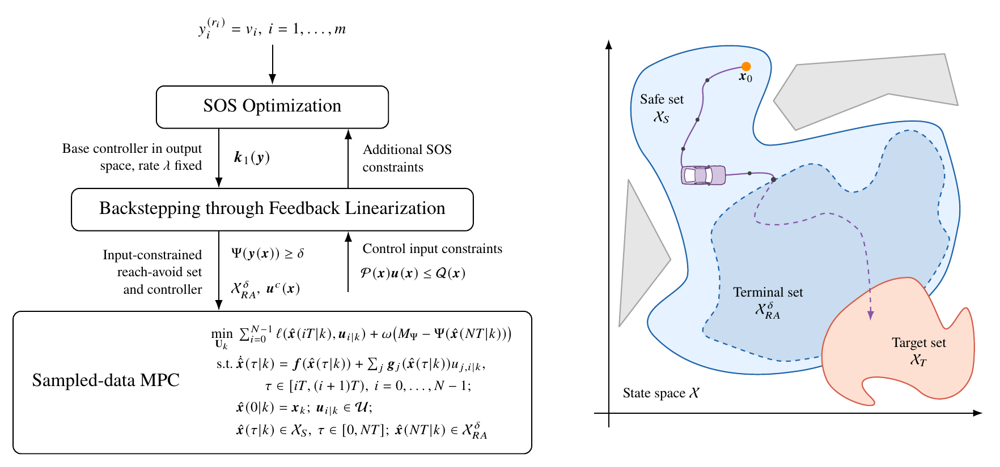
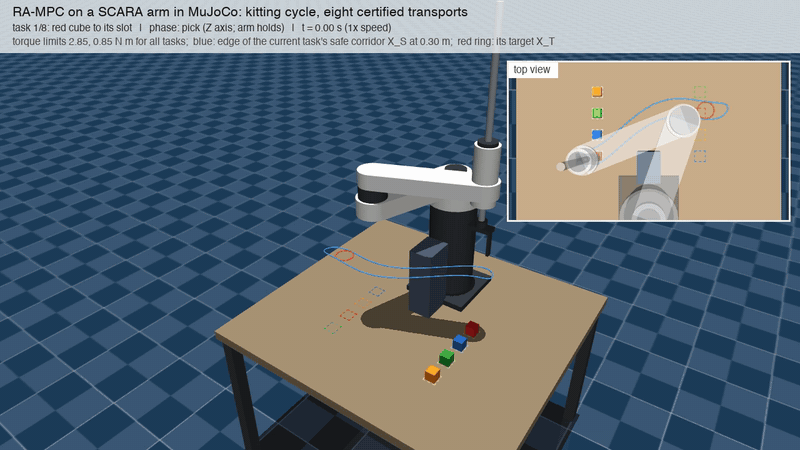
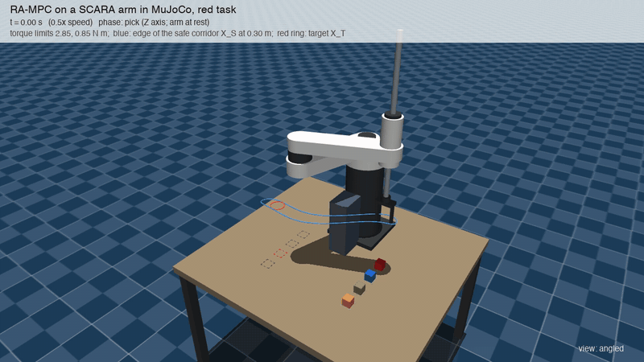

# Reach-Avoid Backstepping MPC

<p align="center">
  
</p>

<p align="center">
  Code and data behind <em>Reach-Avoid Model Predictive Control with Guaranteed
  Recursive Feasibility via Input Constrained Backstepping</em><br/>
</p>

## Simulations

<p align="center">
  RA-MPC on the SCARA arm of Example 2 in MuJoCo. The blue curve is the edge
  of the safe corridor and the red ring is the target set.
</p>

<p align="center">
  
  &nbsp;&nbsp;
  
</p>

<p align="center">
  <em>Left:</em> kitting cycle with eight certified transports, 3x.
  <em>Right:</em> red task of Example 2, angled and top views, 2x.
</p>

## Requirements

| Part                     | Software (versions used)                                                                                                                   |
| ------------------------ | ------------------------------------------------------------------------------------------------------------------------------------------ |
| Certificate synthesis    | MATLAB R2025a with the Symbolic Math Toolbox, [SOSTOOLS](https://github.com/oxfordcontrol/SOSTOOLS) 4.03 and MOSEK 11.0 on the MATLAB path |
| Experiments              | Python 3.11 with numpy 2.4, scipy 1.17, sympy 1.14, casadi 3.7.2 (IPOPT), joblib 1.5 and matplotlib 3.10; conda environment `rab_mpc`      |
| MuJoCo scene (Fig. 6)    | the packages above plus mujoco 3.15 and imageio; conda environment `rab_mujoco`                                                            |

The exact versions are pinned in `environment.yml` (`rab_mpc`) and
`environment-mujoco.yml` (`rab_mujoco`):

```bash
conda env create -f environment.yml && conda activate rab_mpc
```

| Dependency | Version | Licence |
| --- | --- | --- |
| MATLAB, Symbolic Math Toolbox | R2025a | proprietary (MathWorks) |
| [SOSTOOLS](https://github.com/oxfordcontrol/SOSTOOLS) | 4.03 | GPL 3.0 |
| MOSEK | 11.0 | proprietary; free academic licence |
| numpy, scipy, sympy, joblib | 2.4.6, 1.17.1, 1.14.0, 1.5.3 | BSD 3-Clause |
| matplotlib | 3.10.9 | Matplotlib licence (PSF based) |
| CasADi, with the bundled IPOPT | 3.7.2 | LGPL 3.0; IPOPT under EPL 2.0 |
| MuJoCo | 3.15.0 | Apache 2.0 |
| imageio | 2.38.1 | BSD 2-Clause |

No specialised hardware is needed; a multi-core CPU shortens the runs that use
joblib.

## Reproduction

All data behind the paper are committed, so every figure and number can be
regenerated without rerunning the experiments: run `make_figs.py` and
`summarize.py` alone. The experiments use all cores through joblib, except the
timing runs, which should run alone. Run times are for an Apple M5 with 10 cores.

### Example 1, Dubins car (Figs. 4 and 5, Table I)

```bash
cd experiments/dubins
matlab -batch "run('run_design.m')"     # k1.txt; prints the SOS solve time of Table I
python solve_scale.py                   # time scale s from the input bounds and T -> data/scale.json
python verify_inputs_grid.py            # input bounds of u^c on a grid of X_RA^delta
python run_main.py                      # three methods on 300 common initial states (3 min)
python run_lemma2.py                    # sampled-data checks of the terminal controller (4 min)
python run_sweep.py                     # success rate over T = 0.025 ... 1.25 s (20 min)
python run_timing.py                    # computation times of Table I
python make_figs.py                     # figs/
python summarize.py > data/summary.txt  # all numbers
```

### Example 2, SCARA arm (Figs. 7 and 8, Table I)

The workcell, the safe set and the target set are given in `task.json`.

```bash
cd experiments/scara
matlab -batch "run('run_design.m')"     # k1.txt; prints the SOS solve time of Table I
python solve_scale.py                   # time scale s and torque bounds -> data/scale.json
python run_main.py                      # three methods on 150 common initial states (8 min)
python run_lemma2.py                    # sampled-data checks of the terminal controller (1 min)
python run_sweep.py                     # success rate over T = 5 ... 600 ms (80 min)
python run_timing.py                    # computation times of Table I
python make_figs.py                     # figs/
python summarize.py > data/summary.txt  # all numbers
```

### MuJoCo scene (Fig. 6)

In the environment `rab_mujoco`:

```bash
cd experiments/scara/scene
python build_scene.py    # model/scara_arm.xml, model/scene_scara.xml
python demo_traj.py      # RA-MPC transport replayed on the scene -> data/demo.npz
python render_still.py   # ../figs/fig_scara_scene.png
```

## Repository layout

```
.
├── README.md, SUMMARY.md, LICENSE, CITATION.cff
├── environment.yml, environment-mujoco.yml
├── docs/
│   ├── media/              images and animations shown in this README
│   └── readme_figure/      LaTeX source of reach_avoid_mpc.png
└── experiments/
    ├── sos/                SOS program for k1 (SOSTOOLS and MOSEK) and its helpers
    ├── dubins/             Example 1
    └── scara/              Example 2
        └── scene/          MuJoCo scene of Fig. 6
```

Both examples have the same structure:

| File | Content |
| --- | --- |
| `run_design.m`, `k1.txt` | SOS synthesis of `k1` and its result |
| `cert.py` | certificate `Psi` and backstepping controller `u^c` |
| `ra_mpc.py` | Algorithm 1 and the MPC formulations |
| `config.py` | setting of the example and the common initial states |
| `solve_scale.py` | time scale of the terminal controller |
| `run_*.py` | experiments, written to `data/` |
| `make_figs.py`, `figs/` | figures of the paper |
| `summarize.py`, `data/summary.txt` | all numbers behind the paper |

This branch holds what the paper reports. The branch `journal-full` adds what it
does not use: the other seven kitting tasks and the videos, the alternative
figures and diagnostics, the design notes and a Panda-like arm in MuJoCo.

## Licence and citation

The code and data are released under the MIT License, see `LICENSE`; the
dependencies above keep their own licences. `SUMMARY.md` describes the
components of the repository, and `CITATION.cff` gives the citation of the
paper.
