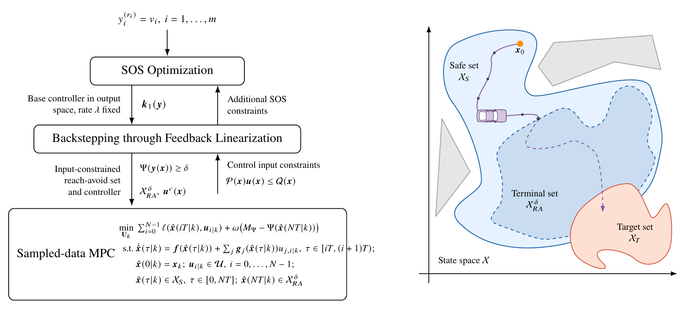
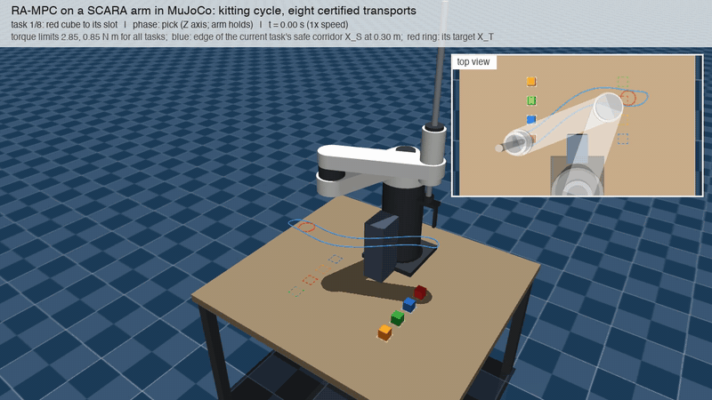
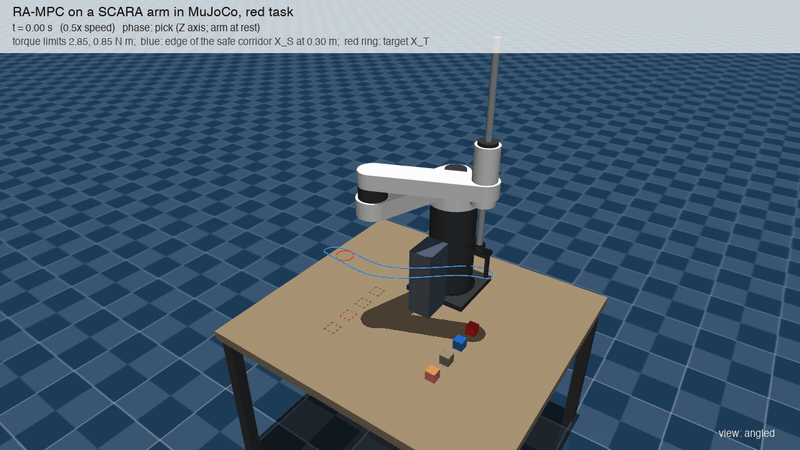

# Reach-Avoid Backstepping MPC

<p align="center">
  
</p>

<p align="center">
  Code and data behind <em>Reach-Avoid Model Predictive Control with Guaranteed
  Recursive Feasibility via Input Constrained Backstepping</em><br/>
</p>

## Simulations

<div align="center">

RA-MPC on the SCARA arm of Example 2 in MuJoCo. The blue curve is the edge of
the safe corridor and the red ring is the target set.

|        Kitting cycle with eight certified transports (3x)        |               Red task, angled and top views (2x)                |
| :--------------------------------------------------------------: | :--------------------------------------------------------------: |
|  |  |

Speed-ups are relative to the full-resolution videos:
[kitting cycle](experiments/strict_xra/scara/figs/scara_cycle.mp4),
[red task](experiments/strict_xra/scara/figs/scara_red_task.mp4).

</div>

## Requirements

| Part                     | Software (versions used)                                                                                                                   |
| ------------------------ | ------------------------------------------------------------------------------------------------------------------------------------------ |
| Certificate synthesis    | MATLAB R2025a with the Symbolic Math Toolbox, [SOSTOOLS](https://github.com/oxfordcontrol/SOSTOOLS) 4.03 and MOSEK 11.0 on the MATLAB path |
| Experiments              | Python 3.11 with numpy 2.4, scipy 1.17, sympy 1.14, casadi 3.7.2 (IPOPT), joblib 1.5 and matplotlib 3.10; conda environment `rab_mpc`      |
| MuJoCo scenes and videos | the packages above plus mujoco 3.15 and imageio; conda environment `rab_franka`                                                            |

```bash
conda create -n rab_mpc python=3.11 numpy scipy sympy matplotlib joblib -c conda-forge
conda activate rab_mpc && pip install casadi
```

## Reproduction

Run times are for an Apple M5 with 10 cores; the experiments use all cores
through joblib, except the timing runs, which run alone. All data behind the
paper are committed, so every figure and summary can also be redrawn without
rerunning the experiments: run `make_figs*.py` and `summarize*.py` alone.

### Example 1, Dubins car (`experiments/strict_xra/`)

```bash
cd design
matlab -batch "DESIGN_TAGS={'W3'}; DESIGN_LAMS=0.06; run('run_design.m')"   # k1/W3_l0.06.txt
cd ../final
python solve_scale.py          # time scale s from the input bounds and T -> data/scale.json
python verify_inputs_grid.py   # input bounds of u^c on a grid of X_RA^delta
python run_main.py             # three methods on 300 common initial states (3 min)
python run_lemma2.py           # sampled-data checks of the terminal controller (5 min)
python run_sweep.py            # success rate over T = 0.025 ... 0.625 s (15 min)
python run_sweep_ext.py        # adds T = 0.417 s and 1.25 s to the sweep
python run_timing.py           # computation times, run alone
python make_figs.py            # all figures -> figs/
python summarize.py            # all numbers, as in PAPER_DUBINS.md
```

### Example 2, SCARA arm (`experiments/strict_xra/`)

```bash
cd arm && LAYOUT=square python screen_racks.py 0.8 0.0     # workcell layout
cd ../arm_top
./run_prep_tasks.sh red_fwd    # task, k1 (MATLAB), mu study and time scale of red_fwd_sq
export TASK=red_fwd_sq LAM=0.1
python calib_horizon.py 30,45,60 30
python run_main_top.py && python run_lemma2_top.py
PERIODS_MS=5,7.5,10,12.5,15,20,25,30,40,50,60,75,100,150,200,300,600 python run_sweep_top.py 150
python run_timing_top.py
python summarize_top.py > data/red_fwd_sq/summary.txt && python make_figs_top.py
# the other seven kitting tasks, under the torque bounds of red_fwd_sq
./run_prep_tasks.sh red_rev blue_fwd blue_rev green_fwd green_rev orange_fwd orange_rev
./run_all_tasks.sh red_rev blue_fwd blue_rev green_fwd green_rev orange_fwd orange_rev
python summarize_all_tasks.py  # data/all_tasks_summary.{json,md}
```

MuJoCo scene, Fig. 6 and the videos, in the environment `rab_franka`:

```bash
cd experiments/strict_xra/scara
python build_scene_scara.py && python scara_demo_traj.py && python render_scara.py --stills
python paper_still.py          # figs/fig_scara_scene.png (Fig. 6)
python cycle_demo_traj.py && python render_cycle.py      # full kitting cycle video (16 min)
./view_scara.sh 0.5            # interactive replay window (macOS)
```

The shell scripts take the Python interpreter from `$PY` (default `python`)
and the MuJoCo environment from `$MUJOCO_ENV` (default the active conda
environment).

## Repository layout

```
.
├── README.md, reach_avoid_mpc.png
├── docs/readme_figure/         LaTeX source of reach_avoid_mpc.png (block diagram and Fig. 1)
├── docs/media/                 GIFs of the MuJoCo videos shown in this README
├── matlab/                     SOS helpers: poly2sym.m, sym2pvar.m
├── python/ra_mpc_dubins.py     Dubins model, vanilla MPC and shared MPC pieces
├── controllers/                letter-version export imported by ra_mpc_dubins.py
└── experiments/strict_xra/
    ├── solve_vanilla_k1_controller.m, solve_vanilla_k1_core.m
    │                           SOS program for k1 (lambda fixed, |k1_i| <= K, scaled outputs)
    ├── design/                 Dubins certificate: run_design.m, cert.py (Psi, u^c),
    │                           ra_mpc_cert.py (Algorithm 1), k1/W3_l0.06.txt
    ├── final/                  Example 1, Dubins car: config.py, solve_scale.py,
    │                           run_*.py, make_figs.py, summarize.py, data/, figs/
    ├── arm/                    workcell layout of Example 2 (screen_racks.py and helpers)
    ├── arm_top/                Example 2, SCARA arm, all eight kitting tasks:
    │                           tasks/, k1/, data/<task>/, figs/<task>/
    ├── scara/                  MuJoCo scene, stills and videos of the SCARA
    └── PAPER_DUBINS.md, PAPER_ARM_TOP.md, PAPER_SCARA.md
                                notes with every number, table and check behind the paper;
                                REPORT.md and STUDY_14_DIRECT.md record the design decisions
```
