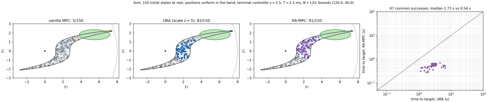
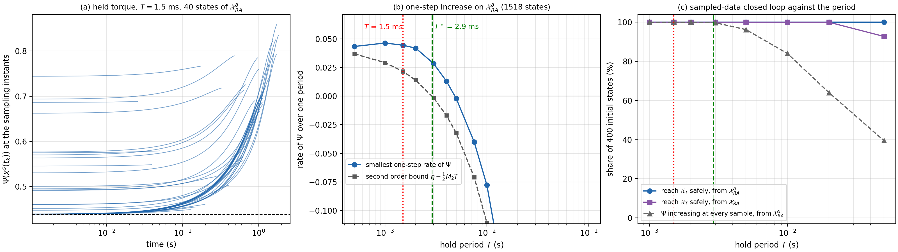
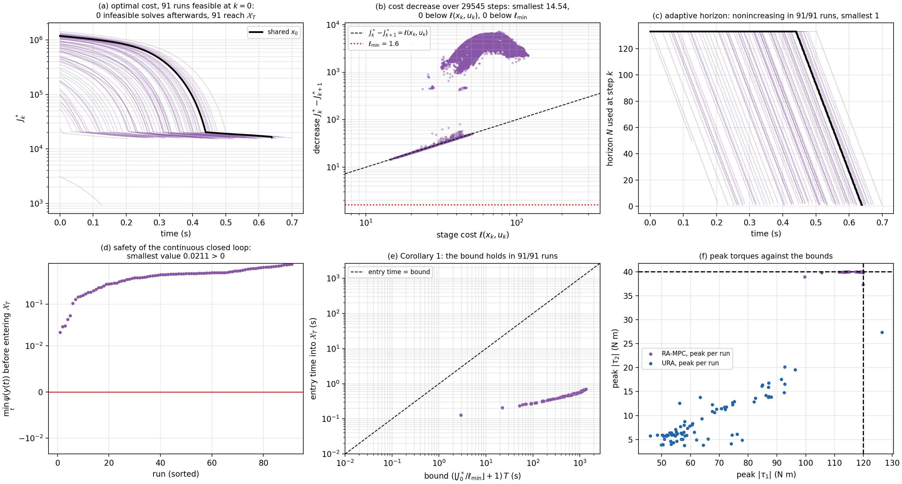
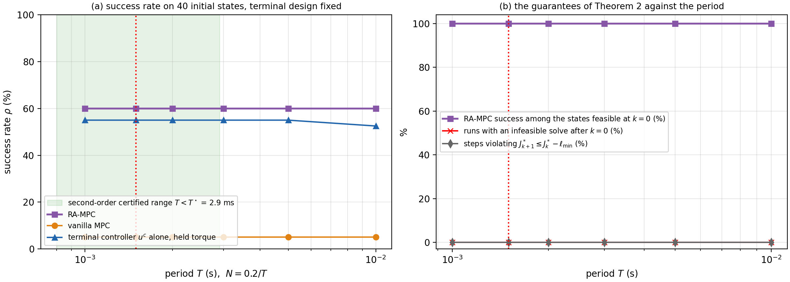
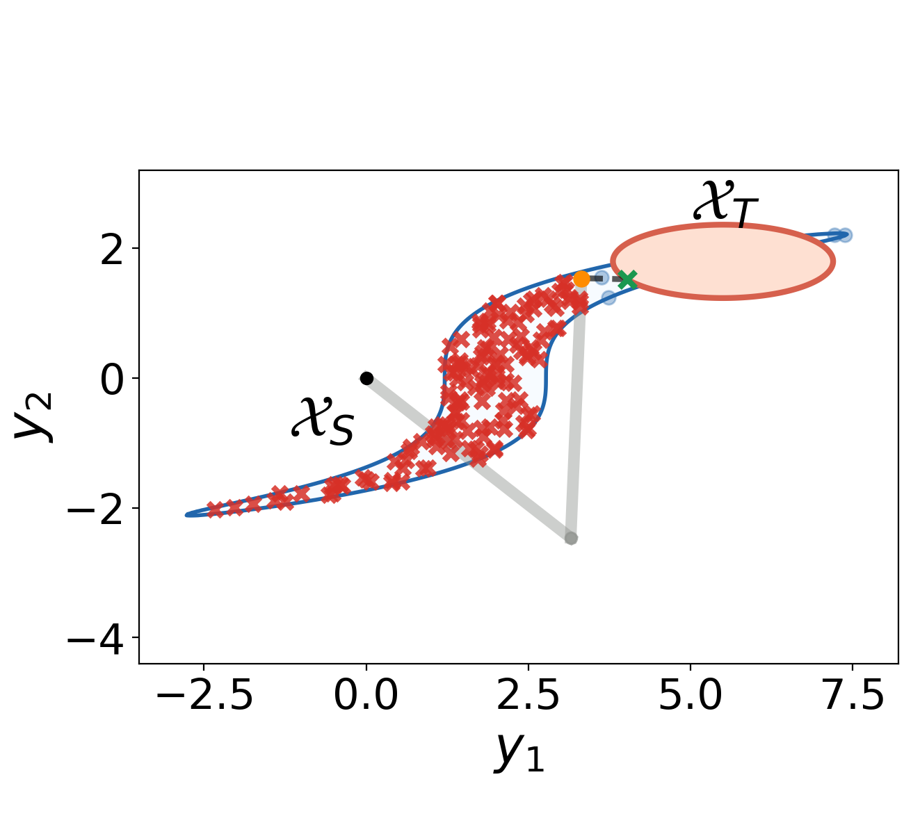
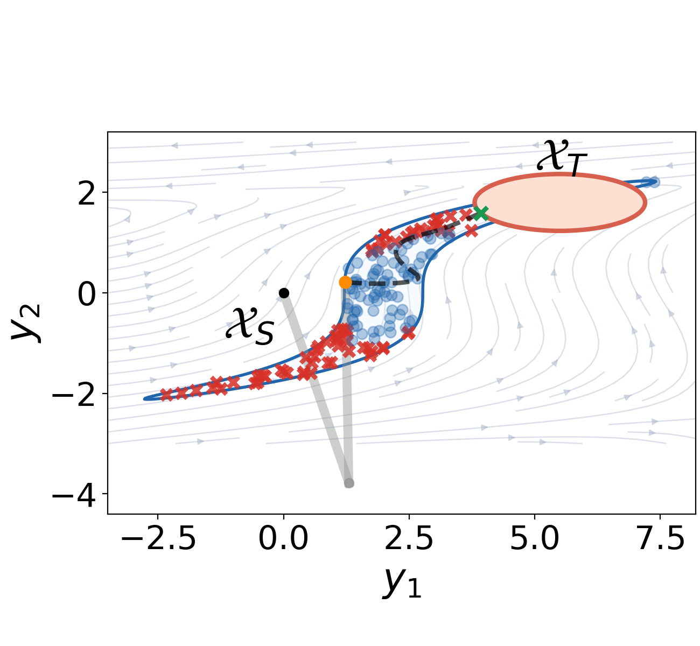
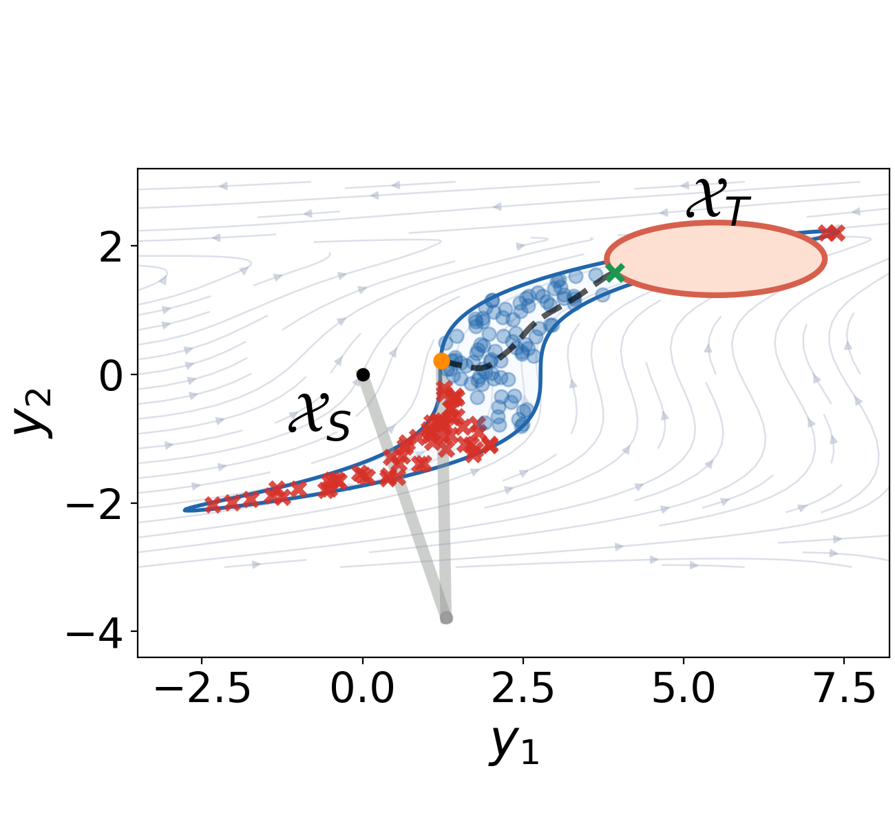
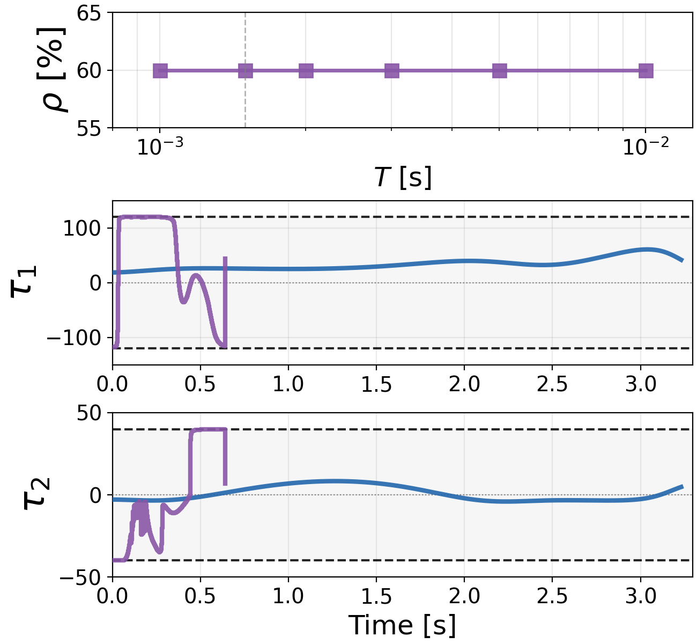
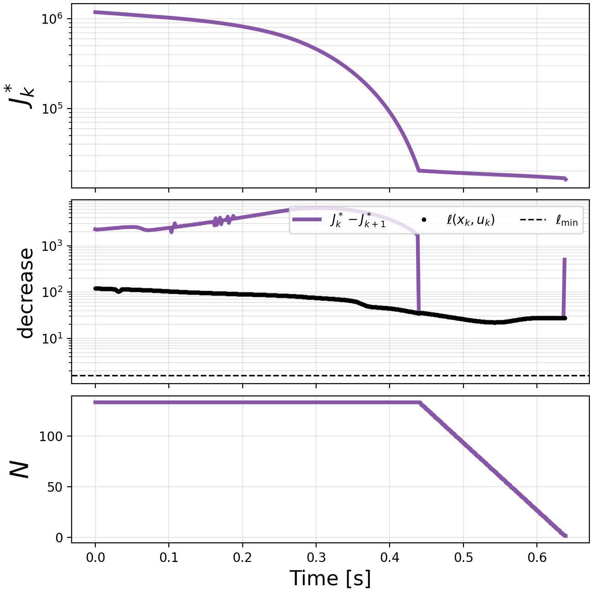

# Two-link arm: setting, data and figures for the paper (option A)

Setting of 2026-10-08, after the audit of `ARM_AUDIT.md`: redesigned safe-set
function, $k_1$ from (12) at the normalised scale, torque held over the period
(option A, no inner-loop gravity compensation), terminal controller at the
time scale $s = 2.5$, $T = 1.5$ ms, $N = 133$ (0.2 s), torque bounds
$(120, 40)$ N m, URA = the same synthesis at $s = 5$, 150 initial states at
rest. Scripts in `arm/` (Section 9). The paper and the notebooks are not
yet changed.

Contents: 1 setting, 2 three-method comparison, 3 Lemma 2, 4 Theorem 2 and
Corollary 1, 5 period sweep, 6 horizon, 7 figures, 8 places to update and
open points, 9 reproduction.

## 1. Setting (Example 2)

### 1.1 Problem data

| item | value | remark |
| --- | --- | --- |
| arm | $m_i = 1$ kg, $l_i = 4$ m, $l_{c,i} = 2$ m, $I_i = 0.02$ kg m$^2$, $g = 9.81$ | unchanged |
| output | end-effector position $y = h(q)$, elbow-down branch | unchanged |
| safe set | $\mathcal{X}_S = \{\psi(y) > 0\}$, $\psi(y) = [(1 + 0.6(y_2 + 2.5))\,b(y) - 0.02\lvert y\rvert^4]/39.04$ with $b$ the band of the paper | new; the band is closed inside the reach ($\lvert y\rvert \le 7.74$, $q_2 \ge 30^\circ$) and $\psi$ has its unique maximum at $(4.21, 1.66) \in \mathcal{X}_T$ |
| target | $\phi(y) = (y_1 - 5.5)^2/1.2^2 + (y_2 - 1.8)^2/0.4^2 - 2 < 0$ | unchanged |
| torque bounds | $\lvert\tau_1\rvert \le 120$, $\lvert\tau_2\rvert \le 40$ N m | were 680 and 500; gravity needs up to 78.5 and 19.6 |

### 1.2 Certificate, scale and terminal controller

| item | value |
| --- | --- |
| $k_1$ | (12) in scaled outputs $y/4$, $\lambda_0 = 0.04$, $\lvert k_{1,i}\rvert \le 1$ m/s, degree 8 (`arm/k1/ARM_l0.04.txt`); $\delta_s/\lambda = 0.123$, 88 % of the band certified |
| $\mu_0$, $\delta$ | $0.1$, $0.5\,M_\Psi$ ($M_\Psi = 0.877$, $\delta = 0.438$) |
| scale rule (`arm/solve_scale_arm.py`) | $s_U = 5.69$ from the bounds on $\mathcal{X}_{RA}^{\delta}$ (quadratic in $s^2$ with the gravity term); sampled largest period with $\Psi$ increasing on every terminal-set state, $T_\varepsilon(s)$: 1.99, 2.64, 2.93, 2.94, 2.80, 2.55, 2.33 ms for $s$ = 1, 1.5, 2, 2.5, 3, 3.5, 4 (5 856 states); chosen $s = 2.5$ (largest $T_\varepsilon$), $T = 1.5$ ms, $T_\varepsilon/T = 1.96$ |
| terminal controller at $s = 2.5$ | $\lambda = 0.100$, $\mu = 0.625$; on $\mathcal{X}_{RA}^{\delta}$ $\lvert\tau\rvert \le (64.7, 10.3)$ N m, on $\mathcal{X}_{RA}$ $(96, 28)$ |
| second-order bound at $s = 2.5$ | $\eta = 4.46 \times 10^{-2}$ (certified rate $\lambda\delta = 4.38 \times 10^{-2}$), $M_2 = 30.7$, $T^\star = 2.90$ ms, so $T = 1.5$ ms is inside it |
| why the period is this short | with a held torque the frozen gravity compensation adds to $M_2$ a part that does not scale ($c_0 \approx 18$, Section 4 of `ARM_AUDIT.md`), so no scale allows more than about 3 ms |
| URA | the same $k_1$ at $s = 5$ ($\lambda = 0.2$, $\mu = 2.5$) |

### 1.3 MPC

| item | value |
| --- | --- |
| period, horizon | $T = 1.5$ ms, $N = 133$ (0.2 s, as in the paper) |
| stage cost | $\ell = 5\lVert y - y^\star\rVert^2 + 10^{-3}\lVert\tau\rVert^2$, $y^\star = (5.5, 1.8)$, $\underline{\ell} = 1.6$ |
| terminal cost | $V_f = \omega (M_\Psi - \Psi)$, $\omega = 3.28 \times 10^6 = 1.2\,\sup\ell/\varepsilon$, $\varepsilon = 3.3 \times 10^{-5}$ (sampled one-step increase at $T$), $\sup\ell = 89.6$ |
| vanilla MPC | same model, cost, constraints, solver and fallbacks; terminal constraint $y_N \in \mathcal{X}_T$, terminal cost $80\lVert y_N - y^\star\rVert^2$ |
| model and constraints | RK4 at the period (one sub-step), $\psi(h(q_k)) \ge 0.005$ at every node, torque bounds |
| solver | IPOPT through `casadi.Opti`, one parametric NLP per horizon length, warm starts; fallback guesses at $k = 0$ as for the Dubins car |
| plant | continuous time, torque held over $T$ (RK4 at 0.5 ms) |

### 1.4 Initial states

150 positions uniform in the band outside the target, at rest, elbow-down.
At rest the decoupling matrix is regular, so this set is natural for the
arm. None of the states lies in the terminal controller's $\mathcal{X}_{RA}$
(with $\mu_0 = 0.1$ the velocity fibre does not contain the rest state at
these positions). Success: the end effector enters $\mathcal{X}_T$ with the
closed loop inside $\mathcal{X}_S$ (URA run for 60 s, MPC for 8 s).

## 2. Three-method comparison

### 2.1 Counts

| | URA ($s = 5$) | vanilla MPC | RA-MPC |
| --- | --- | --- | --- |
| **reach $\mathcal{X}_T$ safely, of 150** | **82** | **5** | **91** |
| runs exceeding the bounds | 1 | 0 | 0 |
| peak $\lvert\tau_1\rvert$, $\lvert\tau_2\rvert$ | 126, 34 | 120, 40 | 120, 40 |

| pair | count |
| --- | --- |
| RA-MPC succeeds, vanilla does not | 88 |
| vanilla succeeds, RA-MPC does not | 2 |
| RA-MPC succeeds, URA does not | 24 |
| URA succeeds, RA-MPC does not | 15 |
| all three | 0 |
| none | 44 |

- The terminal controller alone (continuous or held at 1.5 ms) reaches from
  the same 82 states as URA: a rest state is a fixed point of the time
  scaling, so from rest the two differ only in speed and torque.
- RA-MPC: 59 states infeasible at $k = 0$, none afterwards. The failures are
  the lower tail of the band, from which the terminal set cannot be reached
  in 0.2 s (Section 6).
- Vanilla MPC with the 0.2 s horizon is feasible only next to the target.



### 2.2 URA against RA-MPC

On the 67 states where both succeed:

| quantity | URA | RA-MPC |
| --- | --- | --- |
| time to the target, median (maximum) | 2.73 s (6.58 s) | 0.54 s (0.70 s) |
| accumulated cost, median | 178 | 32 |
| entry speed of the end effector, median (maximum) | | 2.6 m/s (4.4 m/s) |
| share of applied torques within 2 % of the bound | | $\tau_1$ 29 %, $\tau_2$ 62 % |

URA stays below the bounds on all but one run (its torques are mostly the
gravity load); the comparison with the arm is about time, cost and the
domain of attraction, not about bound violations.

Shared start of the trajectory panels: state 114, $y_0 = (1.23, 0.22)$,
4.6 from the target, the farthest state from which URA and RA-MPC succeed
(no state is reached by all three methods); URA 3.23 s, RA-MPC 0.64 s. The
vanilla panel shows the trajectory from its own farthest reached state
(state 38, 2.2 from the target, 0.21 s).

### 2.3 Computation time

Measured on this machine (Apple M5). Per step of the closed loop under the
parallel evaluation: RA-MPC 602 ms on average (first solve 2.2 s with the
fallbacks), vanilla 226 ms. Single-process values: see `arm/data/timing.pkl`
(Section 9). With $T = 1.5$ ms the online time is two orders of magnitude
above the period; this is the price of option A and has to be said in the
paper (the NLP has 800 variables and is rebuilt for each horizon length once).

## 3. Verification of Lemma 2

`arm/run_lemma2_arm.py`, terminal controller at $s = 2.5$, torque held.



| $T$ [ms] | arcs | smallest increase of $\Psi$ | arcs with increasing $\Psi$ | end in $\mathcal{X}_{RA}^{\delta}$ | second-order bound |
| --- | --- | --- | --- | --- | --- |
| 0.5 | 1517 | $+2.2 \times 10^{-5}$ | 100 % | 100 % | $+1.9 \times 10^{-5}$ |
| 1 | 1516 | $+4.6 \times 10^{-5}$ | 100 % | 100 % | $+2.9 \times 10^{-5}$ |
| **1.5** | 1516 | $+6.7 \times 10^{-5}$ | 100 % | 100 % | $+3.2 \times 10^{-5}$ |
| 2 | 1515 | $+8.4 \times 10^{-5}$ | 100 % | 100 % | $+2.8 \times 10^{-5}$ |
| 3 | 1515 | $+8.5 \times 10^{-5}$ | 100 % | 100 % | negative |
| 4 | 1515 | $+5.3 \times 10^{-5}$ | 100 % | 100 % | negative |
| 5 | 1512 | $-1.0 \times 10^{-5}$ | 99.93 % | 99.93 % | negative |
| 10 | 1510 | $-7.8 \times 10^{-4}$ | 99.2 % | 99.3 % | negative |
| 50 | 1482 | $-3.4 \times 10^{-2}$ | 90.4 % | 93.1 % | negative |

Sampled-data closed loop from 400 states of each set (run for 40 s):

| $T$ [ms] | from $\mathcal{X}_{RA}^{\delta}$: reach safely | $\Psi$ increasing at every sample | from $\mathcal{X}_{RA}$: reach safely | $\Psi$ increasing at every sample |
| --- | --- | --- | --- | --- |
| 1 | 400 | 400 | 400 | 385 |
| 1.5 | 400 | 400 | 400 | 372 |
| 2 | 400 | 400 | 400 | 356 |
| 3 | 400 | 399 | 400 | 329 |
| 5 | 400 | 385 | 400 | 281 |
| 10 | 400 | 336 | 400 | 220 |
| 50 | 400 | 158 | 371 | 78 |

Bounds at $s = 2.5$: second-order $T^\star = 2.9$ ms; observed one-step
increase up to 4 ms; observed safe reaching up to 50 ms. $T = 1.5$ ms is
inside the second-order bound and a factor 3 below the first one-step
violation.

## 4. Verification of Theorem 2 and Corollary 1



| claim | check | result |
| --- | --- | --- |
| terminal controller admissible | $u^c$ of the appended candidate within the bounds | every step of every run |
| recursive feasibility | solves after $k = 0$ in the 91 runs feasible at $k = 0$ | 29 636 solves, none infeasible |
| reaches $\mathcal{X}_T$ | | 91 of 91 |
| strictly inside $\mathcal{X}_S$ | smallest $\psi(y(t))$ along the continuous closed loop before the entry | 0.021 > 0 (vanilla 0.005) |
| cost decrease | $J^*_k - J^*_{k+1}$ over 29 545 steps | smallest 14.5, never below $\ell(x_k, u_k)$ or $\underline{\ell} = 1.6$ |
| adaptive horizon | | nonincreasing in 91 of 91, smallest value 1 |
| Corollary 1 | entry time against $(\lfloor J^*_0/\underline{\ell}\rfloor + 1)T$ | holds in 91 of 91; entry median 0.51 s, bound median 751 s |

The candidate was kept in 10 601 of the 29 636 solves. The hypothesis (22)
holds by construction of $\omega$ on the sampled terminal set.

## 5. Period sweep

`arm/run_sweep_arm.py`, 40 states of the initial set, $NT = 0.2$ s,
$\delta$ and $\omega$ fixed:

| $T$ [ms] | $N$ | vanilla MPC | $u^c$ alone, held | RA-MPC | infeasible after $k=0$ | decrease violations | $\min\Delta\Psi$ on $\mathcal{X}_{RA}^{\delta}$ |
| --- | --- | --- | --- | --- | --- | --- | --- |
| 1 | 200 | 2 | 22 | 24 | 0 | 0 of 12 133 | $+3.0 \times 10^{-5}$ |
| 1.5 | 133 | 2 | 22 | 24 | 0 | 0 of 8 099 | $+3.3 \times 10^{-5}$ |
| 2 | 100 | 2 | 22 | 24 | 0 | 0 of 6 070 | $+2.7 \times 10^{-5}$ |
| 3 | 67 | 2 | 22 | 24 | 0 | 0 of 4 044 | $-1.2 \times 10^{-5}$ |
| 5 | 40 | 2 | 22 | 24 | 0 | 0 of 2 426 | $-1.5 \times 10^{-4}$ |
| 10 | 20 | 2 | 21 | 24 | 0 | 0 of 1 208 | $-1.2 \times 10^{-3}$ |



The closed loop is insensitive to the period in this range; the one-step
increase on the terminal set is lost from 3 ms on without any effect on
the runs.

## 6. Horizon

`arm/run_horizon_arm.py`, 40 states, $T = 1.5$ ms:

| $N$ | horizon | vanilla MPC | RA-MPC | vanilla entry speed |
| --- | --- | --- | --- | --- |
| 133 | 0.2 s | 2 | 24 | 3 to 7 m/s (the 5 states of the full set) |
| 267 | 0.4 s | 11 | 27 | |
| 400 | 0.6 s | 38 | 35 | 7 to 11.5 m/s on sampled runs, 20 to 23 m/s on the three states RA-MPC does not reach |

With a long horizon the vanilla MPC reaches more states than RA-MPC, but it
does so by entering the target at up to 23 m/s: the target is a position
set, and nothing stops a plan from crashing into it. RA-MPC has to end in
$\mathcal{X}_{RA}^{\delta}$, whose speeds are below 2.5 m/s, so from 5 m away
it cannot both arrive and brake within 0.6 s; those three states are
genuinely infeasible for it (checked with the vanilla plan as warm start
and 2 000 iterations). Entry speeds of RA-MPC stay below 4.4 m/s at every
horizon.

Two ways to present this: keep the paper's 0.2 s horizon (vanilla 5, RA-MPC
91 of 150, the vanilla failures are then the horizon), or add a joint
velocity limit to the state constraints, which is standard for a robot and
removes the high-speed entries of the vanilla MPC at long horizons (not
run).

## 7. Figures for the paper

Files in `arm/figs/`, PNG and PDF, in the style of the current `fig_manip_*`.

| vanilla MPC, 5/150 | URA, 82/150 | RA-MPC, 91/150 |
| --- | --- | --- |
|  |  |  |



Top: $\rho$ of RA-MPC against $T$ (Section 5). Below: $\tau_1$ and $\tau_2$ from
the shared start, URA in blue (3.23 s), RA-MPC in purple (0.64 s, at the
bounds for most of the run). The `_far` files are the same figures with the
URA and RA-MPC start chosen among the states where only those two succeed
(identical here, since no state is reached by all three).



## 8. Places to update in the paper, and open points

| file | place | change |
| --- | --- | --- |
| `experiment.tex`, Example 2 | safe set | new $\psi$ (1.1) |
| | torque limits "$\lvert\tau_1\rvert \le 680$, $\lvert\tau_2\rvert \le 500$" | 120 and 40 |
| | "$N = 20$ and $T = 0.01$" | $N = 133$, $T = 1.5$ ms, and why (1.2) |
| | captions 76/100, 82/100, 94/100 | 5/150, 82/150, 91/150 (or 100 states if the count is kept) |
| | text on URA | URA within the bounds; 5 times slower and 5.6 times costlier (2.2) |
| | Table I | arm columns after measuring on the paper's machine |
| `figs/` | `fig_manip_*` | replace by `arm/figs/` |

Open points:

1. **Horizon and the vanilla baseline** (Section 6): 0.2 s as in the paper,
   or a velocity limit in the state constraints.
2. **Online time** of 0.5 s per step against a 1.5 ms period (2.3).
3. **Sampled quantities**: $s_U$, $T_\varepsilon$, $\varepsilon$, $\sup\ell$, $\eta$,
   $M_2$ are extrema over samples (1 500 to 5 900 states).
4. **Fewer initial states inside the certified set**: with $\mu_0 = 0.1$ no
   rest state is inside $\mathcal{X}_{RA}$; $\mu_0 = 0.3$ would put 47 of 150
   inside at the price of $T_\varepsilon$ halved (`ARM_AUDIT.md` Section 5).
5. **Notebooks** and `controllers/*acrobot*` untouched.

## 9. Reproduction

```
cd experiments/strict_xra/arm
matlab -batch "run('run_design_arm.m')"      # k1 (lambda 0.02 to 0.2), writes k1/ARM_l*.txt
python solve_scale_arm.py                     # s_U, T_eps(s), chosen s     -> data/scale_arm.json
python run_main_arm.py                        # Sections 2 and 4            -> data/main.pkl     (40 min)
python run_lemma2_arm.py                      # Section 3                   -> data/lemma2.pkl   (1 min)
python run_sweep_arm.py 40                    # Section 5                   -> data/sweep.pkl    (55 min)
python run_horizon_arm.py 267,400 40          # Section 6                   -> data/horizon.pkl  (70 min)
python run_timing_arm.py                      # Section 2.3                 -> data/timing.pkl
python make_figs_arm.py && python summarize_arm.py
```
