# Dubins car: final setting, data and figures for the paper

Setting confirmed on 2026-10-05: certificate R2 of `REPORT.md` Section 11, one
initial set with $r_0 = 0.03$ for all methods, $(\omega_{\max}, a_{\max}) = (3, 3)$,
$N = 25$, $T = 0.05$ s. Everything below is produced by the scripts in
`final/` (Section 9) on the continuous plant. Numbers are final for this
setting; the paper and the notebooks are not yet changed.

Contents: 1 setting, 2 three-method comparison, 3 Lemma 2, 4 Theorem 2 and
Corollary 1, 5 sampling-period sweep, 6 figures for the paper, 7 places to
update in the paper, 8 open points, 9 reproduction.

## 1. Setting (Example 1)

### 1.1 Problem data

| item | value | remark |
| --- | --- | --- |
| output | $y = (x_1, x_2)$ | unchanged |
| safe set | $\mathcal{X}_S = \{\psi(y) > 0\}$, the ring $4 < y_1^4 + y_2^4 < 16$ | set unchanged, $\psi$ changed |
| $\psi$ | $\psi(y) = \alpha(y)\,h(y)/661.409$ | replaces $10^{-3}(300 - \phi)\,h$ |
| $h$ | $h(y) = -(y_1^4 + y_2^4 - 16)(y_1^4 + y_2^4 - 4)$ | unchanged |
| $\alpha$ | $\alpha(y) = (2.5 - y_1)^2 + 0.3\,y_1 y_2^2\,(2.5 - y_1)$ | positive on the ring, minimum 0.25 |
| maximum of $\psi$ | 1, at $y = (-1.794, 0) \in \mathcal{X}_T$ | unique maximum inside the target, as the assumption on the safe and target sets asks |
| target set | $\mathcal{X}_T = \{\phi(y) < 0\}$, $\phi(y) = 4(y_1 + 1.7)^2 + y_2^2 - 0.4$ | the paper prints $y_1^2 + 4(y_2 + 1.7)^2 - 0.4$, indices swapped with respect to the code and the figures |
| input set | $\lvert\omega\rvert \le 3$, $\lvert a\rvert \le 3$ | was 5 |

### 1.2 Certificate and controller

| item | value |
| --- | --- |
| $k_1$ | degree 8, from the SOS program (12) solved in scaled outputs $y/2$ with $\lvert k_{1,i}\rvert \le 1$ and $\lambda$ fixed, then time scaled by $s = 0.159$ (file `design/k1/W3_l0.06.txt`) |
| $\lambda$ | $9.56 \times 10^{-3}$ |
| SOS slack $\delta_s$ | $3.92 \times 10^{-4}$, so $\delta_s/\lambda = 0.0410$ |
| largest field speed | $\max \lvert k_{1,i}\rvert = 0.0996$ m/s on the ring |
| $\mu$ | $5.06 \times 10^{-4}$ |
| $\Psi$ | $\Psi(x) = \psi(y) - \delta_s/\lambda - \lVert \dot y - k_1(y)\rVert^2/(2\mu)$, $M_\Psi = 0.959$ |
| $\mathcal{X}_{RA} = \{\Psi \ge 0\}$ | positions: 76.5 % of $\mathcal{X}_S \setminus \mathcal{X}_T$; speeds between 0.007 and 0.113 m/s |
| terminal margin | $\delta = 0.2\,M_\Psi = 0.192$ |
| $\mathcal{X}_{RA}^{\delta} = \{\Psi \ge \delta\}$ | positions: 37.9 % of $\mathcal{X}_S \setminus \mathcal{X}_T$; speeds between 0.026 and 0.107 m/s |
| $u^c$ on $\mathcal{X}_{RA}^{\delta}$ | $\lvert\omega\rvert \le 0.152$, $\lvert a\rvert \le 0.0059$ (on $\mathcal{X}_{RA}$: 0.205 and 0.0062) |
| offline synthesis | one SOS solve, 1.9 s (MOSEK, this machine); the bounded-input stage is not needed because $u^c$ is far inside the bounds |

### 1.3 MPC

| item | value |
| --- | --- |
| sampling period, horizon | $T = 0.05$ s, $N = 25$ |
| stage cost | $\ell(x, u) = 5\lVert y - y^\star\rVert^2 + 0.05\lVert u\rVert^2$, $y^\star = (-1.7, 0)$, $\underline{\ell} = 0.5$ |
| terminal cost | $V_f = \omega\,(M_\Psi - \Psi)$ with $\omega = 5.94 \times 10^{5}$ |
| how $\omega$ is set | $\omega = 1.2\,\sup\ell/\varepsilon$, with $\varepsilon = 9.3 \times 10^{-5}$ the smallest one-step increase of $\Psi$ on $\mathcal{X}_{RA}^{\delta}$ under ZOH and $\sup \ell = 46.1$ there (both sampled) |
| vanilla MPC | same model, stage cost, constraints and solver; terminal constraint $\hat x(NT) \in \mathcal{X}_T$, terminal cost $80\lVert y_N - y^\star\rVert^2$ |
| prediction model | RK4 with 4 sub-steps per period (12.5 ms) |
| state constraint | imposed at every sub-step node with a back-off of about 1.2 mm (Section 4.2) |
| plant | continuous time, input held over $T$ (RK4 at 5 ms) |

### 1.4 Initial states

One set of 300 states for all methods (`final/config.py`, `initial_set()`).

- Positions: uniform in $\mathcal{X}_S \setminus \mathcal{X}_T$ (the same 300 positions as before).
- Velocities: $\dot y(0) = k_1(y(0)) + w$ with $w$ uniform in the disc of radius
  $r_0 = 0.03$ m/s; $\theta(0)$ and $v(0)$ follow from $\dot y(0)$. The value 0.03
  is the largest velocity radius that $\mathcal{X}_{RA}$ admits, so the sampled
  tube contains every velocity of $\mathcal{X}_{RA}$. Speeds range from 0.005 to
  0.115 m/s.
- 69 of the 300 states lie in $\mathcal{X}_{RA}$ and 32 in $\mathcal{X}_{RA}^{\delta}$.
- Success: the closed-loop trajectory enters $\mathcal{X}_T$ and stays in
  $\mathcal{X}_S$ until then. URA is run for 600 s, the MPC schemes for 20 s.
  For vanilla MPC a state counts when the first problem is feasible; its
  receding-horizon closed loop was then run from all these states and reached
  the target from every one of them.

## 2. Three-method comparison

### 2.1 Success counts (subfigure captions)

| subset of the initial set | states | URA | vanilla MPC | RA-MPC |
| --- | --- | --- | --- | --- |
| **all** | **300** | **229** | **165** | **236** |
| inside $\mathcal{X}_{RA}$ | 69 | 69 | 64 | 68 |
| inside $\mathcal{X}_{RA}^{\delta}$ | 32 | 32 | 32 | 32 |
| outside $\mathcal{X}_{RA}$ | 231 | 160 | 101 | 168 |

| pair | count |
| --- | --- |
| RA-MPC succeeds, vanilla MPC does not | 71 |
| vanilla MPC succeeds, RA-MPC does not | 0 |
| RA-MPC succeeds, URA does not | 23 |
| URA succeeds, RA-MPC does not | 16 |
| all three succeed | 162 |
| none succeeds | 48 |

- URA: 229 reach, 71 leave the safe set. The sampled-data URA with $T = 0.05$ s
  succeeds from exactly the same 229 states.
- RA-MPC: the 64 failures are all infeasible at $k = 0$. No solve is infeasible
  afterwards (Section 4).
- The single state of $\mathcal{X}_{RA}$ that RA-MPC misses lies outside
  $\mathcal{X}_{RA}^{\delta}$ ($\Psi = 0.09$, far side of the ring) and becomes
  feasible with $N = 30$. The guarantee of Theorem 2 concerns the states
  feasible at $k = 0$, which include all of $\mathcal{X}_{RA}^{\delta}$ (32 of 32).

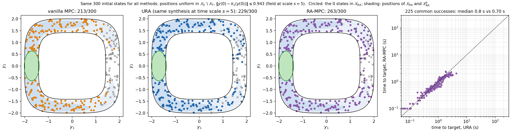

### 2.2 URA against RA-MPC: time, cost, inputs

On the 213 states where both succeed (cost: accumulated stage cost
$\int \ell\,dt$ up to the entry into $\mathcal{X}_T$):

| quantity | URA | RA-MPC |
| --- | --- | --- |
| time to the target, median | 24.0 s | 1.25 s |
| time to the target, maximum | 135.7 s | 2.20 s |
| accumulated cost, median | 214.8 | 14.0 |
| largest $\lvert\omega\rvert$ | 0.146 rad/s | 3.0 rad/s (bound) |
| largest $\lvert a\rvert$ | 0.0068 m/s$^2$ | 3.0 m/s$^2$ (bound) |
| share of applied inputs within 2 % of the bound | none | $\omega$ 15 %, $a$ 91 % |

Median ratios per state: URA is 20 times slower and 16 times more costly. On
the 162 states where all three succeed the medians are 18.4 s (URA), 0.90 s
(vanilla MPC) and 1.05 s (RA-MPC).

URA never exceeds the input bounds here (at most 6 % of $\omega_{\max}$ and
0.2 % of $a_{\max}$ over all 300 runs). The statement of the current text that the unconstrained
controller "severely violates actuator limits" no longer holds. What the
comparison shows is that URA has to be slow to be certifiable, whereas the MPC
uses the admissible inputs up to the bounds and is faster by a factor 20.

Shared initial state of the trajectory panels and of the input plot: state
230, $x_0 = (0.3765, -1.7589, -2.9683, 0.0688)$, the farthest state from which
all three methods succeed. Times to the target: vanilla MPC 1.35 s, URA 36.5 s,
RA-MPC 1.70 s.

### 2.3 Computation time (Table I)

Measured on this machine (Apple M5, one process, 12 runs per method), not on
the i5-13400 named in the paper. The values of the table have to be measured
again on the paper's machine.

| method | offline | online per step, mean (median) |
| --- | --- | --- |
| vanilla MPC | none | 49.8 ms (43.4 ms) |
| URA | 1.9 s | 0.23 ms |
| RA-MPC | 1.9 s | 68.7 ms (66.7 ms) |

- Both MPC schemes now use the 4-sub-step model with the state constraint at
  the sub-step nodes and tight solver tolerances, which is why they are
  slower than the 28.9 ms and 30.8 ms of the current table.
- The RA-MPC step takes longer than $T = 0.05$ s on this machine. No effort
  went into solver speed (IPOPT through `casadi.Opti`, problem rebuilt at
  every step).
- The offline time of RA-MPC equals that of URA because the bounded-input
  synthesis stage is not active. The sampled constants ($\varepsilon$, $\omega$,
  $\eta$, $M_2$) take a few seconds more.

## 3. Verification of Lemma 2

Lemma 2: for $T < T^\star$ the sampled-data closed loop under $u^c$ stays in
$\mathcal{X}_S$ and enters $\mathcal{X}_T$ in finite time; the proof shows that
$\Psi$ increases by a uniform amount from one sampling instant to the next.
Script `final/run_lemma2.py`, states sampled inside the sets (half of them on
the boundary in the velocity directions).

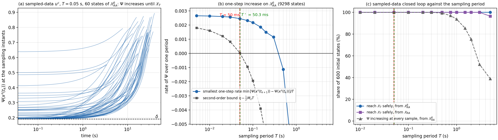

### 3.1 At the paper's period $T = 0.05$ s

| check | result |
| --- | --- |
| one ZOH step from 76 896 states of $\mathcal{X}_{RA}^{\delta}$ (76 809 arcs that do not enter $\mathcal{X}_T$): $\Psi$ increases | all, smallest increase $1.04 \times 10^{-4}$ |
| same arcs: end state in $\mathcal{X}_{RA}^{\delta}$, arc inside $\mathcal{X}_{RA}$ | all |
| closed loop from 600 states of $\mathcal{X}_{RA}^{\delta}$: reach $\mathcal{X}_T$ inside $\mathcal{X}_S$ | 600 of 600, median 17.2 s |
| same runs: $\Psi$ increases at every sampling instant | 600 of 600, smallest step $9.8 \times 10^{-5}$ |
| closed loop from 600 states of $\mathcal{X}_{RA}$ | 600 of 600 reach, $\Psi$ increasing in all |

Panel (a) shows $\Psi$ at the sampling instants for 60 of these runs.

### 3.2 Against the sampling period

One ZOH step from 9 298 states of $\mathcal{X}_{RA}^{\delta}$ (arcs that enter
$\mathcal{X}_T$ are left out):

| $T$ [s] | smallest increase of $\Psi$ | arcs with increasing $\Psi$ | end in $\mathcal{X}_{RA}^{\delta}$ | second-order bound $\eta T - \tfrac12 M_2 T^2$ |
| --- | --- | --- | --- | --- |
| 0.005 | $+1.3 \times 10^{-5}$ | 100 % | 100 % | $+1.2 \times 10^{-5}$ |
| 0.01 | $+2.6 \times 10^{-5}$ | 100 % | 100 % | $+2.3 \times 10^{-5}$ |
| 0.02 | $+5.2 \times 10^{-5}$ | 100 % | 100 % | $+3.8 \times 10^{-5}$ |
| 0.05 | $+1.2 \times 10^{-4}$ | 100 % | 100 % | $+3.6 \times 10^{-5}$ |
| 0.1 | $+2.2 \times 10^{-4}$ | 100 % | 100 % | negative |
| 0.2 | $+3.0 \times 10^{-4}$ | 100 % | 100 % | negative |
| 0.3 | $+3.5 \times 10^{-4}$ | 100 % | 100 % | negative |
| 0.5 | $-5.6 \times 10^{-4}$ | 99.93 % | 99.93 % | negative |
| 1 | $-1.3 \times 10^{-2}$ | 98.4 % | 98.6 % | negative |
| 2 | $-9.2 \times 10^{-2}$ | 90.9 % | 93.0 % | negative |
| 5 | $-1.1$ | 64.5 % | 71.7 % | negative |

Sampled-data closed loop from 600 states of each set (run for 400 s):

| $T$ [s] | from $\mathcal{X}_{RA}^{\delta}$: reach safely | $\Psi$ increasing at every sample | from $\mathcal{X}_{RA}$: reach safely | $\Psi$ increasing at every sample |
| --- | --- | --- | --- | --- |
| 0.01 to 0.2 | 600 | 600 | 600 | 600 |
| 0.3 | 600 | 600 | 600 | 597 |
| 0.5 | 600 | 596 | 600 | 589 |
| 1 | 600 | 563 | 600 | 539 |
| 2 | 600 | 452 | 600 | 384 |
| 3 | 600 | 313 | 600 | 258 |
| 5 | 600 | 234 | 579 | 157 |

### 3.3 Sampling-period bounds

| bound on $T$ | value |
| --- | --- |
| closed form of the current proof, $\beta(T)/\lambda < \delta$, constants sampled on $\mathcal{X}_{RA}^{\delta}$ ($M_g = 3.6,\ 52.6$; $\ell_{u^c} = 4.94,\ 0.10$; $M_v = 0.155$) | 0.51 ms |
| second-order bound $2\eta/M_2$ with the certified rate $\eta = \lambda\delta = 1.83 \times 10^{-3}$, $M_2 = 0.0797$ | 46.0 ms |
| second-order bound with the sampled $\eta = \min\dot\Psi = 2.01 \times 10^{-3}$ | 50.3 ms |
| observed: $\Psi$ increases over one step from every sampled state of $\mathcal{X}_{RA}^{\delta}$ | up to 0.3 s |
| observed: the sampled-data closed loop reaches $\mathcal{X}_T$ safely from every sampled state | up to 3 s |

Reading: the conclusion of Lemma 2 holds at $T = 0.05$ s with a factor 6 to the
first violation of the increase and a factor 60 to the first failure. The
bounds are conservative, and $T = 0.05$ s sits at the edge of the second-order
bound (Section 8, point 1).

## 4. Verification of Theorem 2 and Corollary 1

Data: the 300 RA-MPC runs of Section 2 (`final/run_main.py`).

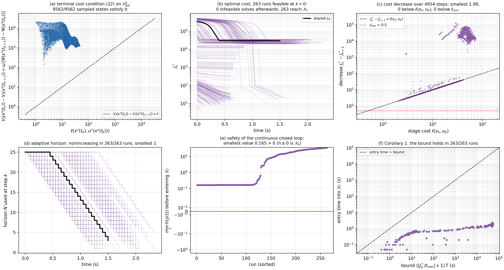

### 4.1 Checks

| claim | check | result |
| --- | --- | --- |
| hypothesis (22) on the terminal cost | $\omega\,[\Psi(x^s(t_{k+1})) - \Psi(x^s(t_k))] \ge \ell(x^s(t_k), u^c)$ on 76 809 sampled states of $\mathcal{X}_{RA}^{\delta}$ | all; $\omega$ times the smallest increase is 61.9 against $\sup \ell = 46.1$ |
| terminal controller admissible | $u^c$ of the appended candidate step within the bounds | every step of every run |
| recursive feasibility | solves after $k = 0$ in the 236 runs feasible at $k = 0$ | 5 921 solves, none infeasible |
| reaches $\mathcal{X}_T$ | runs feasible at $k = 0$ that enter the target | 236 of 236 |
| strictly inside $\mathcal{X}_S$ | smallest $h$ along the continuous closed loop before the entry, 2.5 ms resolution | 0.165 > 0, no run with a negative value |
| cost decrease | $J^*_k - J^*_{k+1}$ over 5 685 steps | smallest 1.60; never below $\underline{\ell} = 0.5$; never below $\ell(x_k, u_k)$ beyond solver tolerance (ratio at least 0.999 998 8) |
| adaptive horizon | $N$ along each run | nonincreasing in 236 of 236, shortened in all of them, smallest value 1 |
| Corollary 1 | entry time against $(\lfloor J^*_0/\underline{\ell}\rfloor + 1)\,T$ | holds in 236 of 236 |

- Entry times: median 1.30 s, maximum 2.20 s. Bound of Corollary 1: between
  0.95 s and 45 704 s, median 12 344 s. The bound is loose by four orders of
  magnitude for most states because $V_f$ with $\omega = 5.9 \times 10^5$
  dominates $J^*_0$. It is tight only near the target.
- The candidate was kept instead of the solver output in 3 356 of the 5 921
  solves. Once the horizon is being shortened the tail of the previous plan is
  optimal, the decrease equals $\ell(x_k, u_k)$, and the points of panel (c)
  lie on the diagonal.

### 4.2 Safety between sampling instants

With the state constraint imposed at the sampling instants only, as in all
earlier runs and in the L-CSS code, 114 of the 236 successful RA-MPC runs left
$\mathcal{X}_S$ between two sampling instants, by at most 1.2 mm
($h \ge -0.16$). The MPC problem of Theorem 2 constrains
$\hat x(\tau \mid k)$ for all $\tau$, so this was an implementation gap and not a
counterexample. The final runs impose the constraint at the four RK4 sub-step
nodes of every period with a back-off of 0.05 in the units of the safe-set
function (about 1.2 mm at the inner boundary). Both MPC schemes use it. Effect
on the counts: vanilla MPC 166 to 165, RA-MPC 236 to 236 (two states lost, two
gained).

## 5. Sampling-period sweep

`final/run_sweep.py`: $T$ varies with $NT = 1.25$ s, and the terminal design is
kept at its base values ($\delta = 0.192$, $\omega = 5.94 \times 10^5$). Model
sub-steps and constraint nodes stay at 12.5 ms for every $T$. Same 300 states.

| $T$ [s] | $N$ | vanilla MPC | sampled-data URA | RA-MPC | $\rho$ of RA-MPC | infeasible after $k=0$ | steps violating the decrease | $\min \Delta\Psi$ on $\mathcal{X}_{RA}^{\delta}$ |
| --- | --- | --- | --- | --- | --- | --- | --- | --- |
| 0.025 | 50 | 165 | 229 | 233 | 77.7 % | 0 | 0 of 11 572 | $+5.2 \times 10^{-5}$ |
| 0.03125 | 40 | 165 | 229 | 235 | 78.3 % | 0 | 0 of 9 194 | $+6.3 \times 10^{-5}$ |
| **0.05** | **25** | **165** | **229** | **236** | **78.7 %** | **0** | **0 of 5 685** | $+9.3 \times 10^{-5}$ |
| 0.0625 | 20 | 165 | 230 | 236 | 78.7 % | 0 | 0 of 4 437 | $+1.1 \times 10^{-4}$ |
| 0.125 | 10 | 162 | 231 | 235 | 78.3 % | 0 | 0 of 2 072 | $+1.6 \times 10^{-4}$ |
| 0.25 | 5 | 165 | 231 | 231 | 77.0 % | 0 | 0 of 943 | $+6.2 \times 10^{-5}$ |
| 0.3125 | 4 | 165 | 232 | 228 | 76.0 % | 0 | 0 of 732 | $-7.7 \times 10^{-5}$ |
| 0.625 | 2 | 150 | 232 | 218 | 72.7 % | 0 | 0 of 508 | $-2.0 \times 10^{-3}$ |

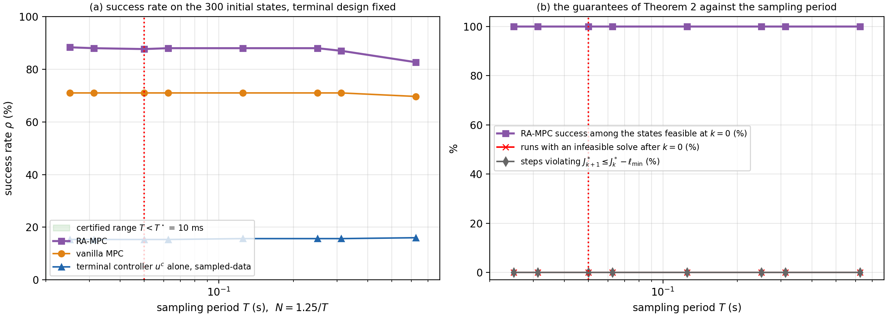

- For every $T$, every run that is feasible at $k = 0$ reaches the target, no
  run is unsafe or times out, and vanilla-feasible states are RA-MPC feasible
  without exception.
- Inside the range $T \le 0.05$ s the success rate is constant up to three
  states (233 to 236). The three missing at $T = 0.025$ s are failures of the
  first solve, not infeasibility: that problem contains the one at
  $T = 0.05$ s.
- Beyond it the rate falls slowly, to 72.7 % at $T = 0.625$ s. The loss is in
  the set of states feasible at $k = 0$ (coarser input parametrisation), not in
  recursive feasibility.
- The current sentence of the paper, that the drop of $\rho$ with $T$
  "directly corroborates" Lemma 2, is not what these data show. They show that
  the guarantees hold on the certified range and that nothing breaks for
  periods six to twelve times longer, which is the conservatism of Section 3.3.

## 6. Figures for the paper

Files in `final/figs/`, PNG and PDF, same names, size and style as the current
figures in `TAC/figs/`, so they can be copied over once confirmed.

### 6.1 Three method panels (figure* in `method.tex`)

| vanilla MPC, 165/300 | URA, 229/300 | RA-MPC, 236/300 |
| --- | --- | --- |
| 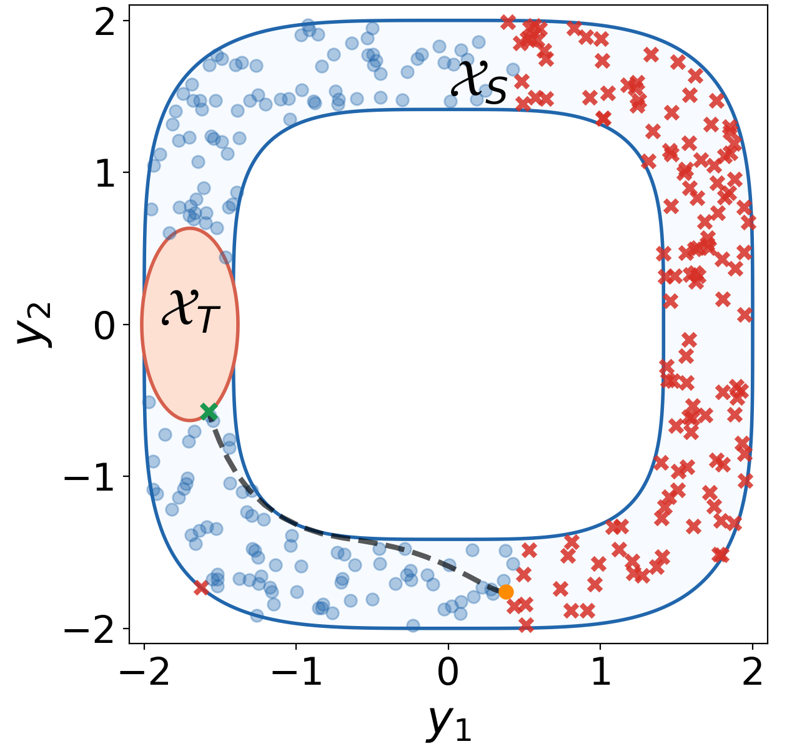 | 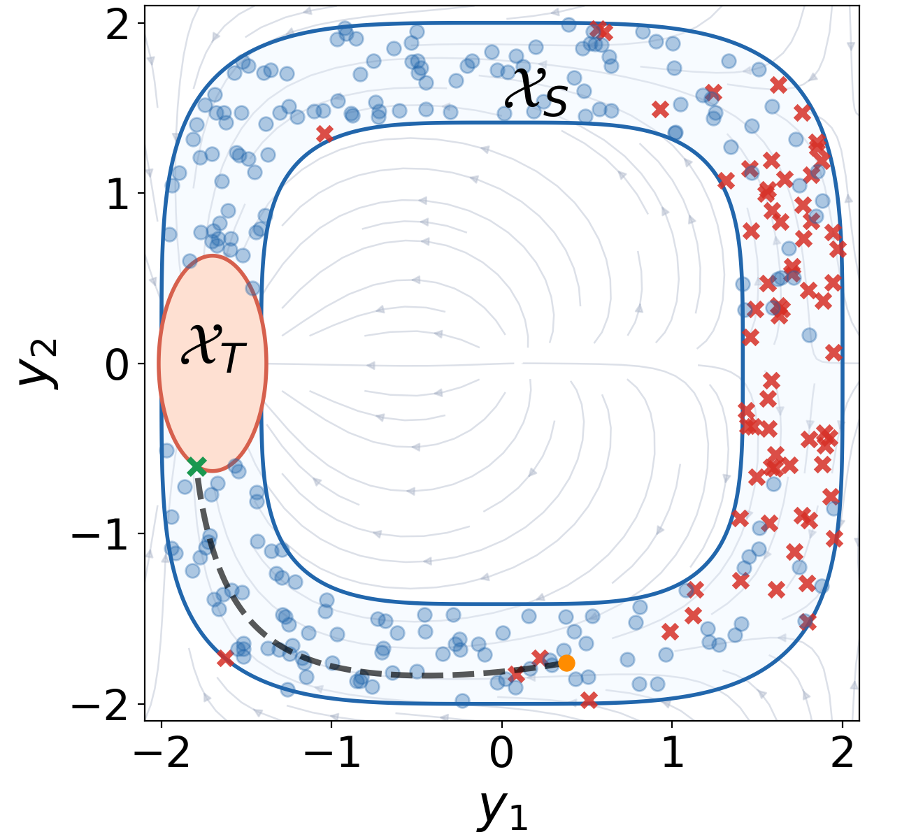 | 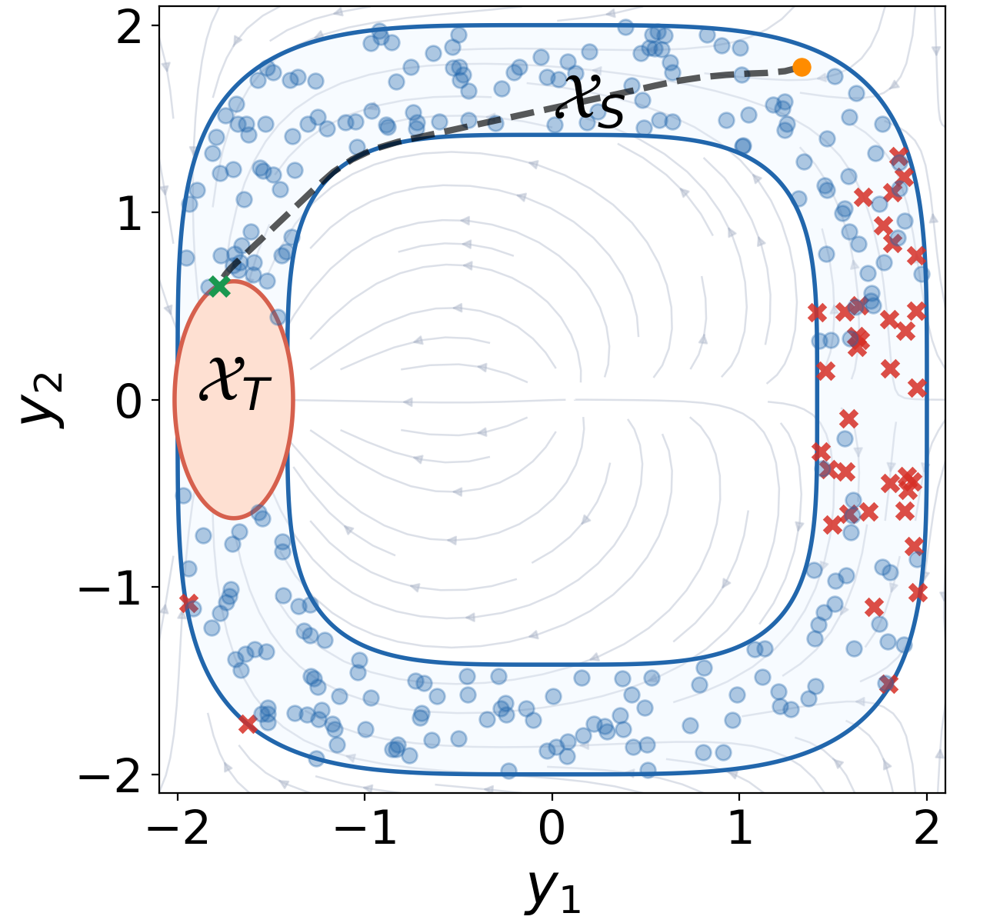 |

Blue dots succeed, red crosses fail, the dashed line is the closed loop from
the shared initial state, the grey streamlines are $k_1$.

### 6.2 Sweep and inputs (`fig_dubins_compare`)

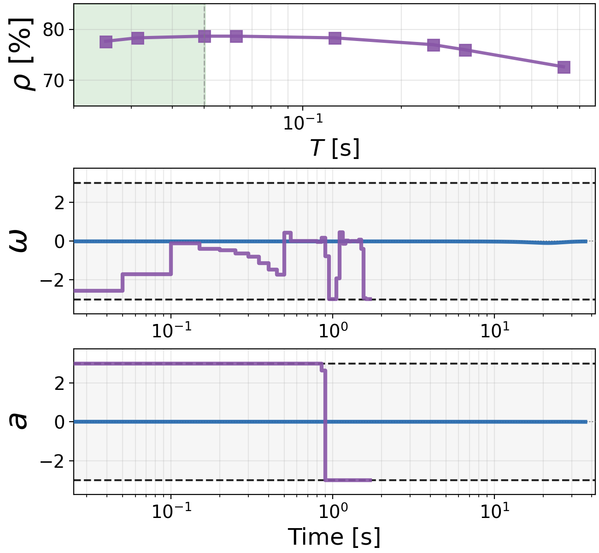

Top: $\rho$ of RA-MPC against $T$ (Section 5), shaded for $T < T^\star$, dashed
line at $T = 0.05$ s; the $\rho$ axis is zoomed to the range of the data (65 to
85 %). Below: $\omega$ and $a$ from the shared initial state, URA in blue
(36.5 s) and RA-MPC in purple (1.70 s), bounds dashed. The time axis is
logarithmic because the two durations differ by a factor 20 (the script
switches to a linear axis automatically when they differ by less than a
factor 6).

### 6.3 Optional: cost and horizon (`fig_dubins_cost`)

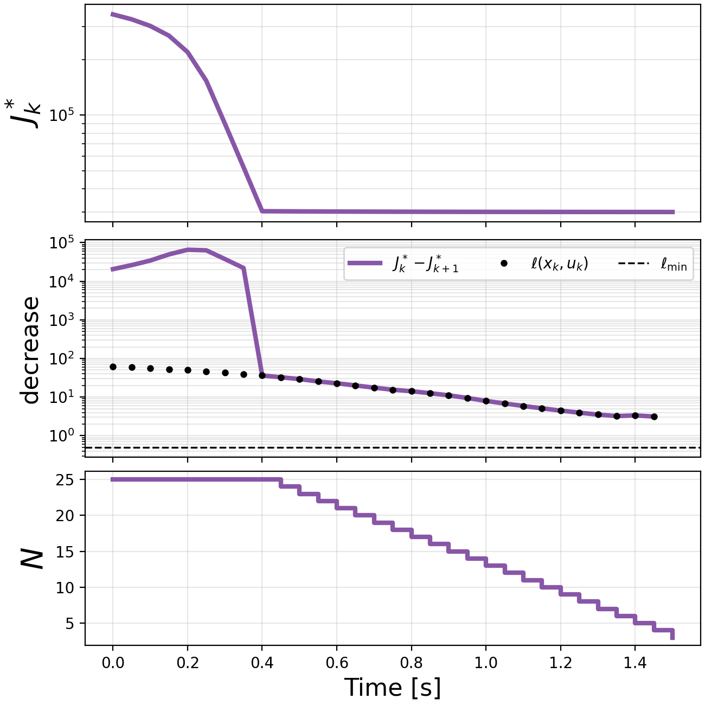

Three rows for the shared initial state: $J^*_k$, the decrease
$J^*_k - J^*_{k+1}$ against the stage cost $\ell(x_k, u_k)$ and
$\underline{\ell}$, and the horizon used at step $k$. $J^*_k$ looks flat after
0.55 s because the terminal cost $\omega\,(M_\Psi - \Psi)$ of the shortened
plan stays at about $2.8 \times 10^4$ while each step removes only
$\ell(x_k, u_k)$, between 3 and 30; the middle row shows this decrease
directly, equal to $\ell(x_k, u_k)$ once the horizon is being shortened and
far above it before. Not in the paper at present.

### 6.4 Variant with a farther start (`*_far` files)

Under the rule "one start from which all three methods succeed", the farthest
start is state 230 at $(0.38, -1.76)$, 2.7 from the target, because vanilla
MPC is only feasible within about 1.25 s of the target. The `_far` files drop
vanilla MPC from the rule: URA and RA-MPC start from state 236 at
$(1.78, -1.51)$, 3.8 from the target, on the far side of the ring (URA 62.1 s,
RA-MPC 2.20 s), and the vanilla panel keeps its own farthest feasible start,
state 230 (1.35 s).

| vanilla MPC, own start | URA, far start | RA-MPC, far start |
| --- | --- | --- |
| 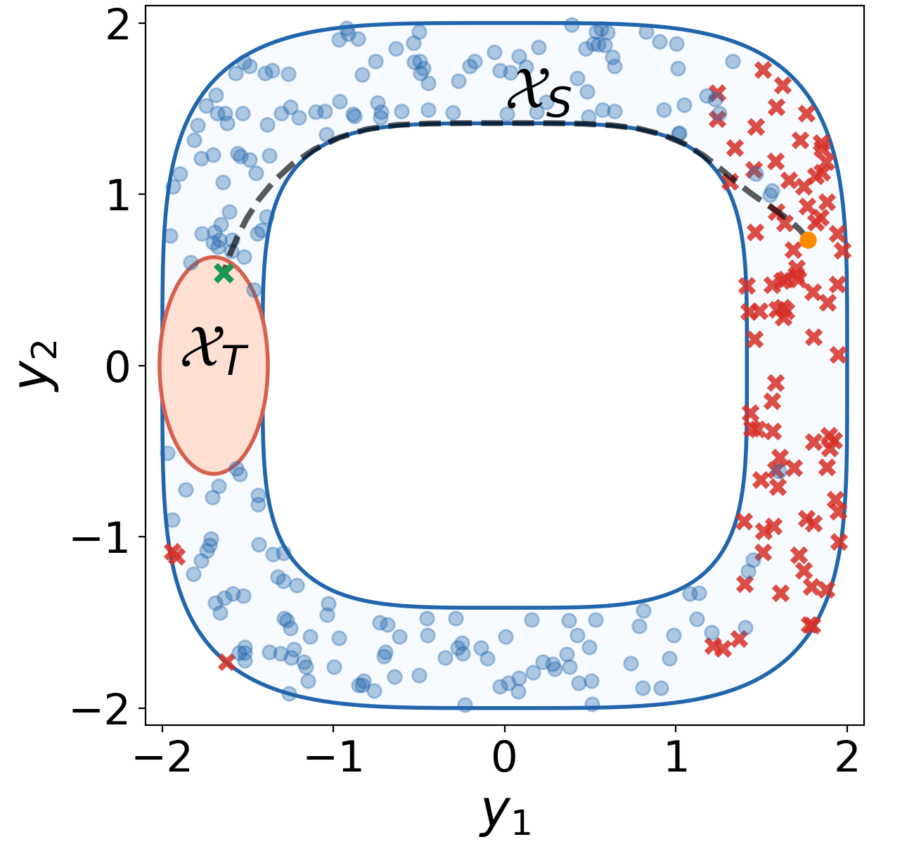 | 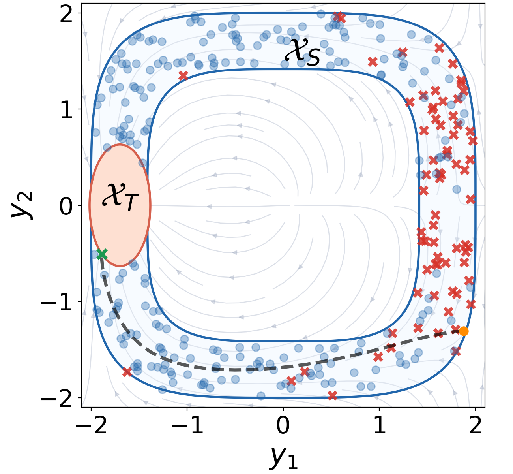 | 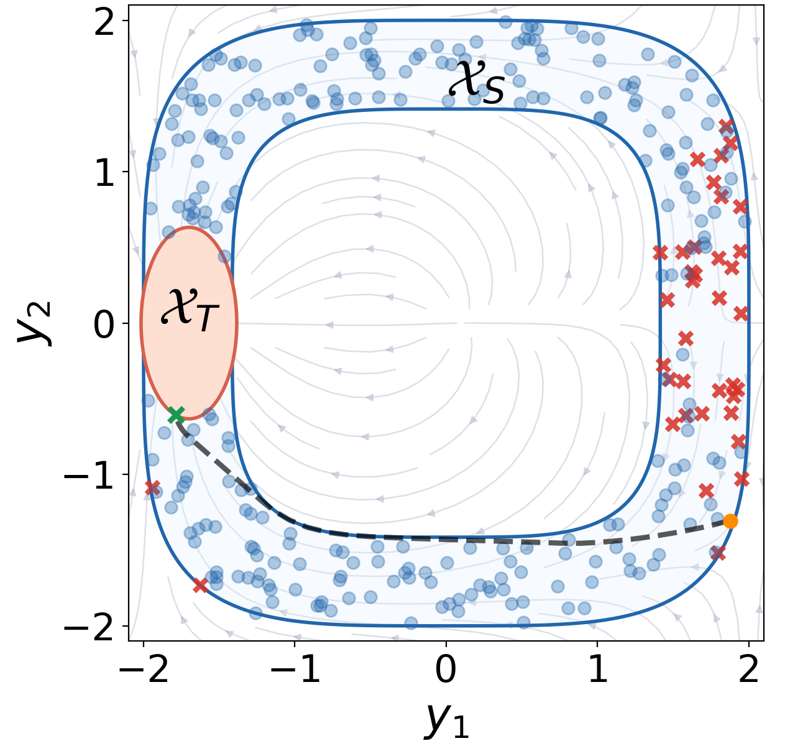 |

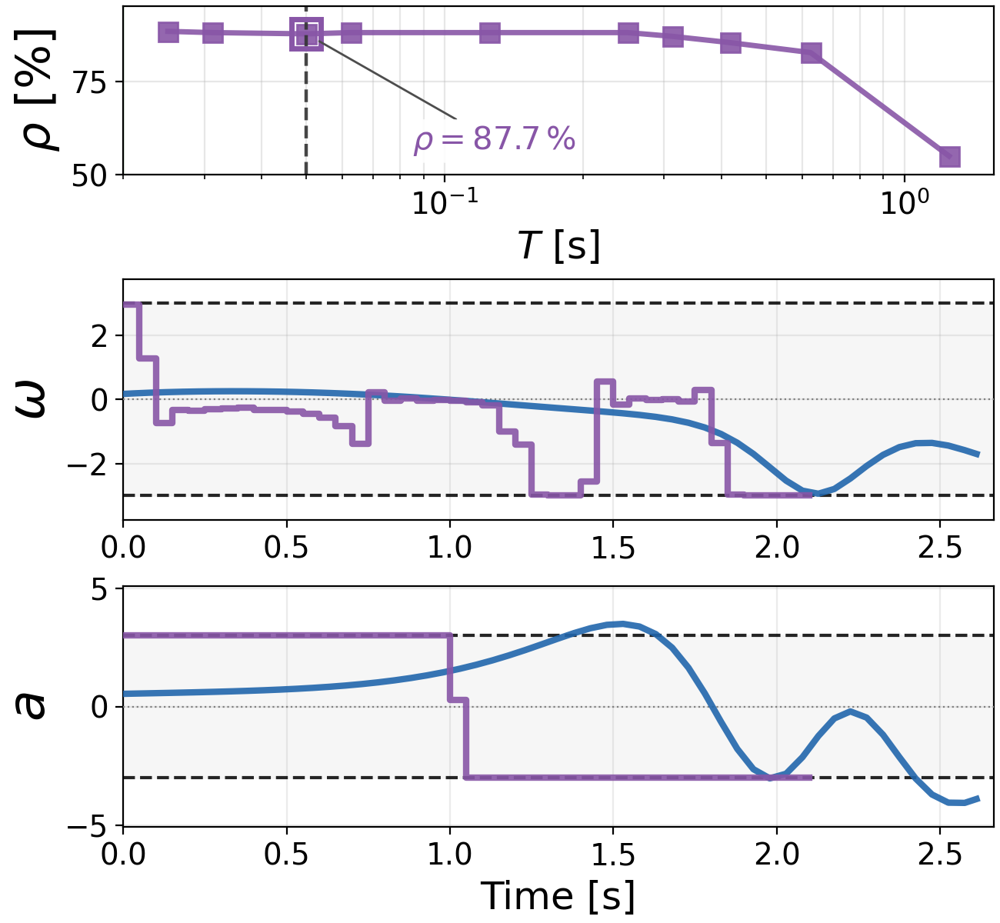

### 6.5 URA and the input bounds

With this certificate the controller alone does not exceed the bounds, at any
start of the initial set and at any time scale that keeps it useful
(`final/run_ura_scale.py`, `final/alt_set.py`):

| URA | initial set | reaches | exceeds the bounds | peak $\lvert\omega\rvert$, $\lvert a\rvert$ | median time |
| --- | --- | --- | --- | --- | --- |
| terminal controller, $s = 0.159$ (paper) | confirmed set | 229 | 0 of 300 | 0.17, 0.007 | 24 s |
| unscaled design, $s = 1$ | confirmed set | 84 (215 leave $\mathcal{X}_S$) | 64, all $\omega$ spikes near $v = 0$ | 108, 0.20 | 20 s |
| unscaled design, $s = 1$ | set around its own field, $r_0 = 0.19$, speeds 0.03 to 0.72 | 229 | 0 of 300 | 1.1, 0.27 | 4.1 s |
| $s = 2$ | confirmed set | 51 | 136, $\omega$ spikes near $v = 0$ | 1255, 0.85 | 11 s |
| $s = 3$ | confirmed set | 48 | 198, $\omega$ spikes near $v = 0$ | 2061, 1.8 | 7.5 s |

The only violations are the $1/v$ singularity of $\omega = \ddot y \cdot n / v$
at starts that are almost at rest, and they occur at starts within 0.85 of
the target. A trajectory on which URA exceeds the bounds while RA-MPC stays
inside therefore does not exist for this design; the old figure had one
because the old gains were uncertified. On the set around the unscaled
field (third row) the counts are URA 229, vanilla 183, RA-MPC 239, with
vanilla-feasible states again a subset of the RA-MPC ones.

## 7. Places to update in the paper

| file | place | change |
| --- | --- | --- |
| `Example_dubins.tex` | definition of $\psi$ and $\phi$ | new $\psi$ (1.1); fix the swapped indices in $\phi$ |
| `Example_dubins.tex` | "300 safe initial states randomly sampled outside the target set" | describe the initial set (1.4) |
| `Example_dubins.tex` | "actuator limits $\lvert u_{1,2}\rvert \le 5$" | 3; $N = 25$ and $T = 0.05$ s stay |
| `Example_dubins.tex` | certificate data | $\lambda$, $\mu$, $\delta$, $\omega$ if they are to be reported (1.2, 1.3) |
| `Example_dubins.tex` | URA "severely violates actuator limits and delays convergence" | URA respects the bounds; it is 20 times slower and 16 times more costly (2.2) |
| `Example_dubins.tex` | sweep sentence on Lemma 2 | see Section 5, last point |
| `method.tex` | captions of the figure* | 165/300, 229/300, 236/300 instead of 245, 197, 255 |
| `experiment.tex` | Table I | Dubins columns, after measuring on the paper's machine (2.3) |
| `experiment.tex` | caption of `fig_dubins_compare` | shaded range and logarithmic time axis if the figure is adopted |
| `figs/` | `fig_dubins_vanilla`, `fig_dubins_uncon`, `fig_dubins_rampc`, `fig_dubins_compare` | replace by the files of `final/figs/` |

## 8. Open points

1. **$T = 0.05$ s against the bound.** With the bound of the current proof the
   hypothesis $\delta > \beta(T)/\lambda$ of Theorem 2 does not hold at
   $T = 0.05$ s (it needs $T < 0.51$ ms). With the second-order bound,
   $T^\star$ is 50.3 ms for the sampled rate and 46.0 ms for the certified rate
   $\lambda\delta$, so $T = 0.05$ s is on the edge. A slower time scale
   $s = 0.14$ in place of 0.159 gives 52 ms with the certified rate (everything
   is then rerun, about 30 minutes, and URA becomes 13 % slower). Alternatives:
   $T = 0.04$ s, or stating the condition through the sampled one-step increase
   $\varepsilon > 0$, which holds with a wide margin.
2. **Form of Lemma 2.** Whichever option is taken in point 1, the closed-form
   bound of the current proof cannot certify the period used. The second-order
   form (`REPORT.md` Section 10.3) is the one behind the 46 to 50 ms.
3. **Sampled constants.** $\eta$, $M_2$, $\varepsilon$, $\sup\ell$ and hence
   $\omega$ are extrema over samples (9 298 to 76 896 states), not certified
   bounds.
4. **Corollary 1 is loose** for this terminal weight (Section 4.1).
5. **Online time above $T$** on this machine (Section 2.3).
6. **Manipulator example**: not audited, still with the old design.
7. **Notebooks** `example_dubins_car_*.ipynb` and `make_paper_figs_dubins.ipynb`
   still run the committed controller; `controllers/*.py` is untouched.

## 9. Reproduction

```
cd experiments/strict_xra/final
python run_main.py      # Section 2 and 4   -> data/main.pkl      (3 min)
python run_lemma2.py    # Section 3         -> data/lemma2.pkl    (5 min)
python run_sweep.py     # Section 5         -> data/sweep.pkl     (15 min)
python run_timing.py    # Section 2.3       -> data/timing.pkl    (1 min, run alone)
python make_figs.py     # all figures       -> figs/
python summarize.py     # prints the numbers and tables of this file
```

`config.py` holds the setting (certificate, bounds, horizon, initial set,
constraint handling). The MPC class is `design/ra_mpc_cert.py`; the options
`nsub`, `safe_sub`, `safe_margin` added for Section 4.2 are off by default, so
the earlier scripts of `design/` reproduce the earlier numbers.

## 10. Variant under review: URA at time scale $s = 5$ (`final/data_s5`, `final/figs_s5`)

Run with `TAG=_s5 SET_SCALE=5 URA_SCALE=5`. Only two things change with respect
to Sections 1 to 6: the URA baseline is the same synthesis at time scale
$s = 5$ ($k_1 \to 5 k_1$, $\lambda = 0.30$, $\mu = 0.51$, field speeds up to
3.1 m/s), and the initial velocities are drawn around that field with the
radius scaled accordingly ($r_0 = 0.943$, speeds 0.15 to 3.6 m/s). Terminal
controller ($s = 0.159$), bounds, horizon, period, certificate and the
Lemma 2 data are unchanged.

| | URA ($s = 5$) | vanilla MPC | RA-MPC |
| --- | --- | --- | --- |
| reach $\mathcal{X}_T$ safely | 229 | 213 | 258 |
| runs exceeding the bounds | 170 (158 among the successes) | 0 | 0 |
| peak $\lvert\omega\rvert$, $\lvert a\rvert$ over all runs | 5.4, 6.7 | 3, 3 | 3, 3 |
| time to the target, median (225 common successes of URA and RA-MPC) | 0.80 s | | 0.70 s |
| vanilla-feasible but RA-MPC-infeasible | | 0 | |
| infeasible solves after $k = 0$ | | | 0 |

Theorem 2 checks on the 258 runs: no infeasible solve after $k = 0$, cost
decrease at least 2.08 per step, horizon nonincreasing in all runs, smallest
$h$ along the closed loops 0.164, Corollary 1 bound holds in 258 of 258.
Sweep: $\rho$ = 86.0, 86.3, 86.0, 86.3, 85.7, 84.3, 81.7, 78.3 % for
$T$ = 0.025 to 0.625 s, no infeasible solve after $k = 0$ at any $T$. Solve
times (one process): RA-MPC 73.4 ms, vanilla 48.1 ms per step.

Shared start: state 6, $x_0 = (1.330, 1.776, -2.820, 1.733)$, 3.5 from the
target; vanilla 1.20 s, URA 1.47 s with peaks $\omega$ 3.5 and $a$ 5.7 (0.66 s
above the bounds), RA-MPC 1.75 s within the bounds.

| vanilla MPC, 213/300 | URA, 229/300 | RA-MPC, 258/300 |
| --- | --- | --- |
| 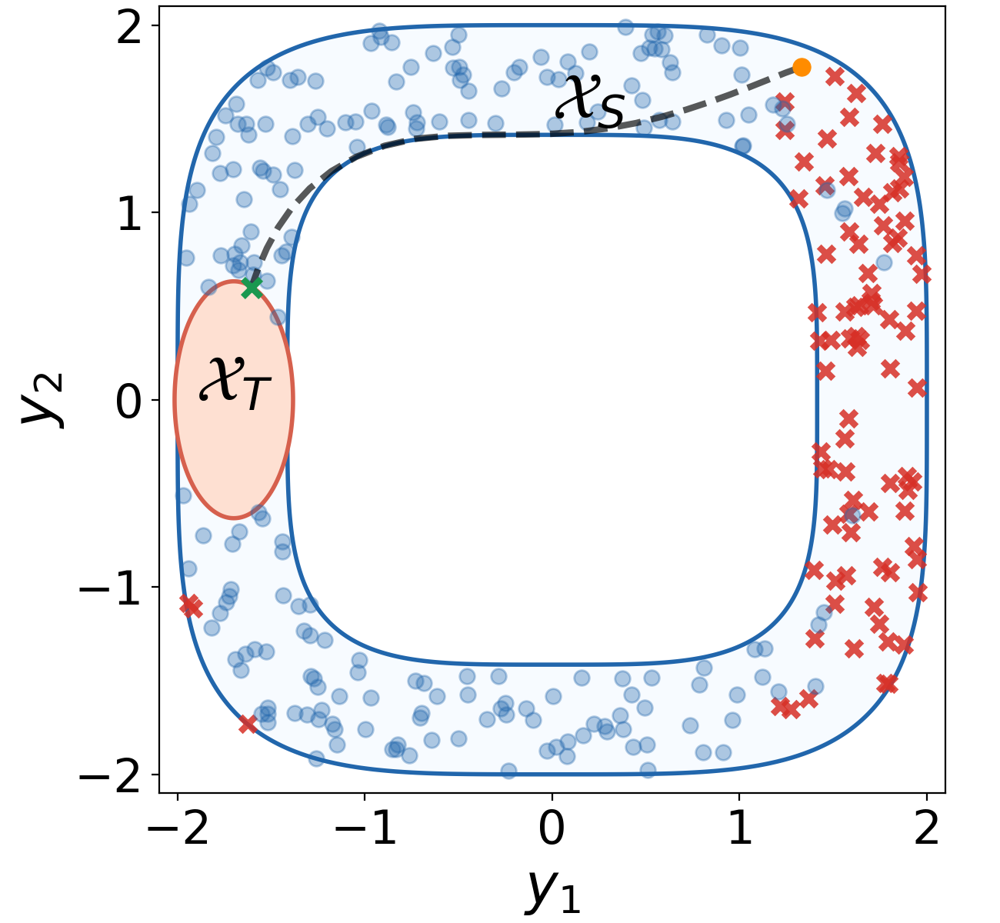 | 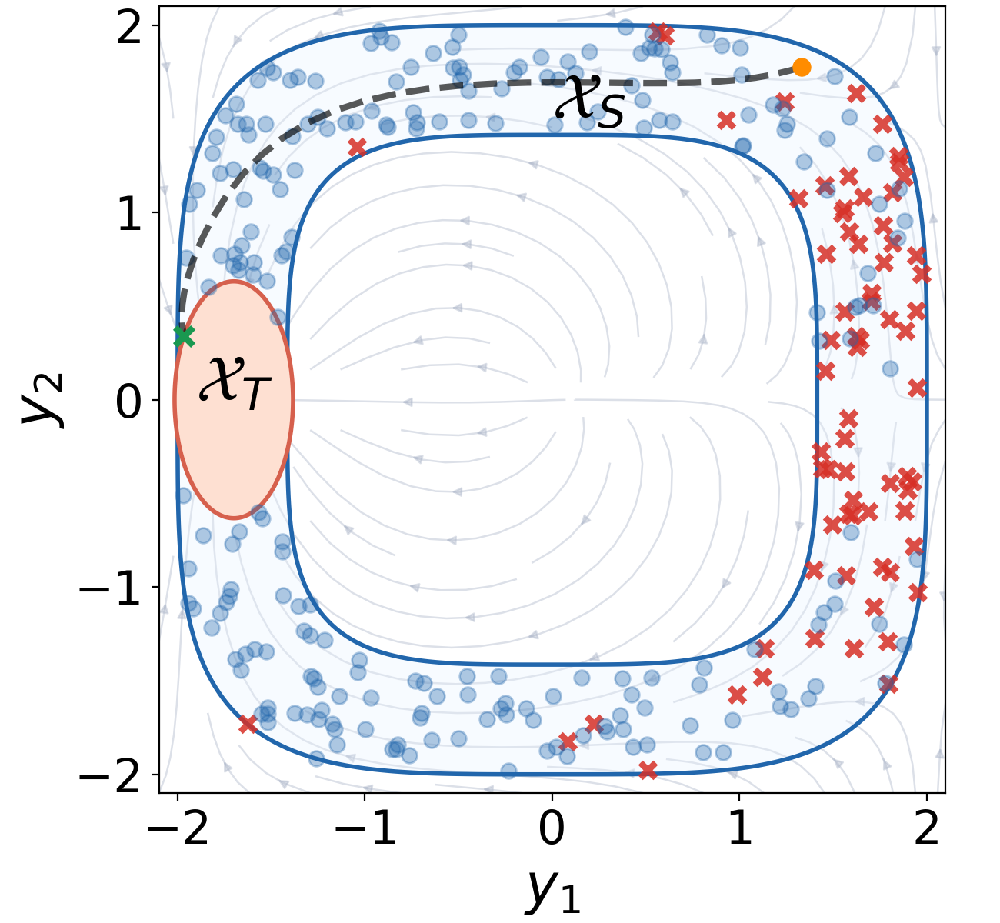 | 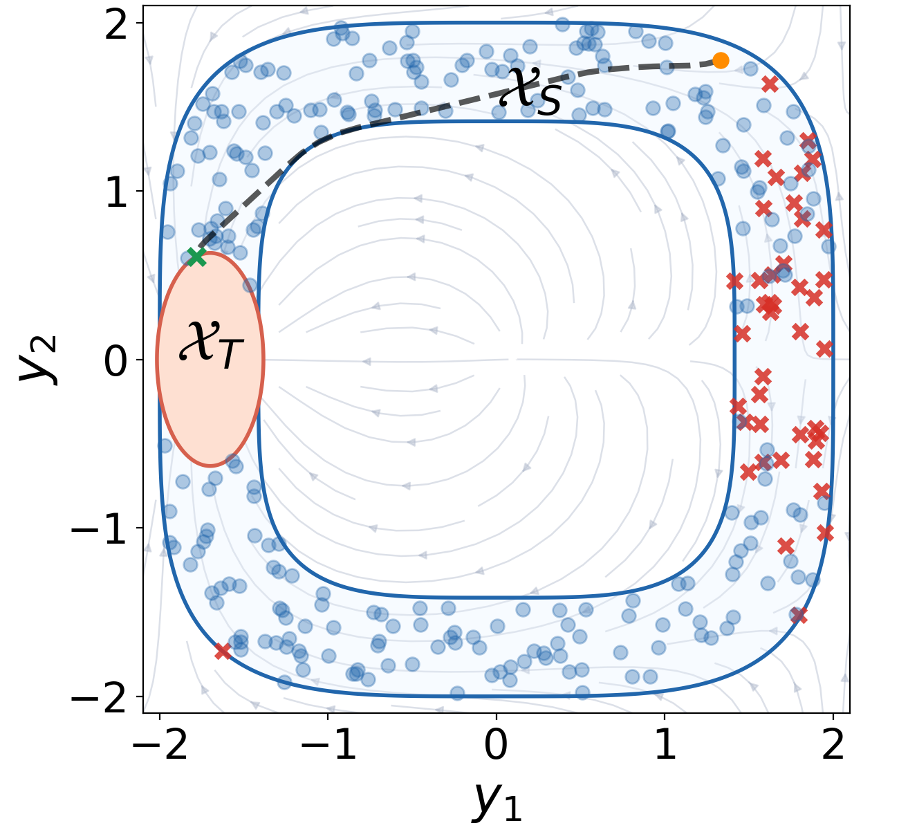 |

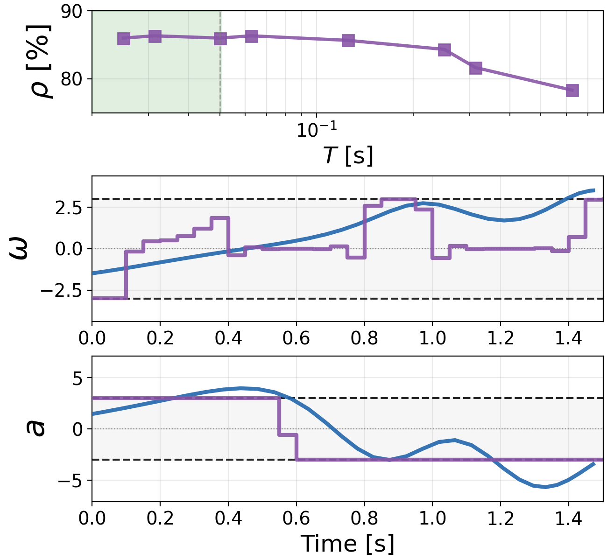

Verification figures of this variant: `final/figs_s5/verify_outcomes.png`,
`verify_theorem2.png`, `verify_sweep.png`.
